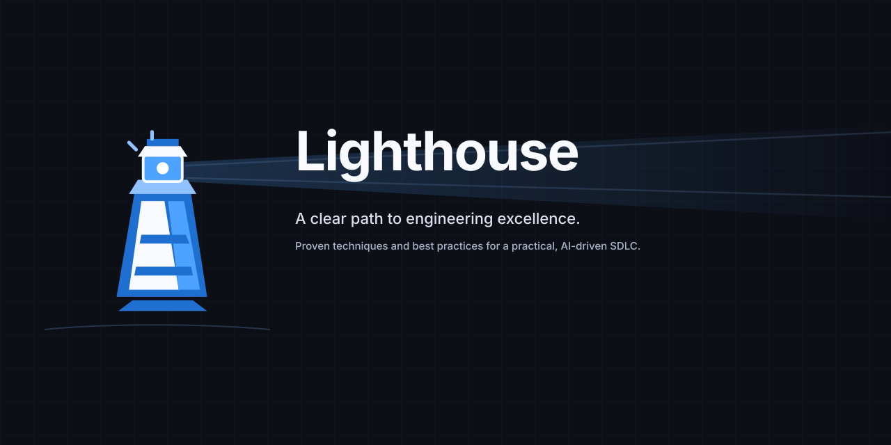

# Lighthouse

[](https://juangcarmona.github.io/lighthouse/)

Lighthouse provides the engineering baseline and agent workflows for taking a GitHub issue through refinement, implementation, independent verification and integration. It combines repository guardrails, delivery contracts and retained evidence in packages that adopters install and configure in their own repositories.

ProductShape owns product intent, ArcShape owns architecture evidence and Lighthouse owns the delivery baseline. Each product keeps its own decisions, infrastructure and credentials.

## What you can use

| Surface | Available behavior | Guide |
| --- | --- | --- |
| Repository harness | Initialize or adopt a repository, select profiles, verify guardrails and preview managed-file upgrades without overwriting customizations. | [CLI](src/packages/cli/README.md) |
| Agent delivery | Route owner requests to refinement, proposal, implementation and review workers; update the same PR after feedback; integrate when the configured checks and approvals permit it. | [SDLC](src/packages/sdlc/README.md) |
| Validation and recovery | Run independent checks, bind evidence to the candidate, retain blocked and failed outcomes, reconcile interrupted work and optionally attempt bounded CI repair. | [Operator guide](src/packages/sdlc/github-actions.md), [completion](src/packages/sdlc/completion.md) |
| Unattended delivery | Opt into bounded fast-forward and test-first hotfix routes, or serial delivery of dependent epic children. | [Unattended routes](src/packages/sdlc/unattended.md), [epics](src/packages/sdlc/epic-delivery.md) |
| Application profiles | Generate a .NET backend with Minimal APIs, CQRS and analyzer checks; adopt guidance for React, BFFs, PWAs, Expo and MAUI. | [Profiles](src/packages/cli/assets/profiles/catalog.json), [.NET](src/dotnet/profile/README.md) |
| Visual contract | Reuse semantic CSS tokens, native component recipes and the design guide through a separate package. | [UI](src/packages/ui/README.md) |

## Start with a repository

Requires Node.js 22 or later. This example uses the registry-qualified CLI 0.12.47, which selects SDLC 0.20.14 and UI 0.2.1. It needs no Lighthouse source checkout. In the repository you want to adopt:

```sh
npm install --save-dev --save-exact @juangcarmona/lighthouse@0.12.47
npx --no-install lighthouse init --name MyProduct --dry-run
npx --no-install lighthouse init --name MyProduct
npx --no-install lighthouse verify
```

Review the initializer's preview before writing. Existing files are preserved and reported as conflicts. Verification reports missing integrations and adoption gaps; follow the [CLI guide](src/packages/cli/README.md) to configure the relevant authorities and checks. Commit the package lock and selected configuration.

For an existing repository, start with the [adoption steps](src/packages/cli/README.md#existing-repository). To create a backend in a new directory, use `lighthouse create-dotnet <empty-target> --name MyProduct`; the [.NET profile](src/dotnet/profile/README.md) describes SDK requirements and verification.

## Enable agent workflows

Workflow installation is a separate opt-in. The [SDLC guide](src/packages/sdlc/README.md#install-or-update-workflows) covers the installer, labels and immutable source or published-package pins. Configure the runtime, credentials, independent verification commands and completion policy through the [operator guide](src/packages/sdlc/github-actions.md) before enabling automation.

For the package-only route, install gh-aw 0.93.2 and preview the completion, Product Change and maintenance workers from the installed package:

```sh
node node_modules/@juangcarmona/lighthouse-sdlc/src/install-workflows.mjs . package --with-completion --with-product-change --with-maintenance
```

Review the preview before repeating with `--apply`. Differing existing workflows also require `--replace-reviewed`. Commit the source workflows, compiled locks, action pins and adopter configuration together. Configure eligible push/PR CI and the repository-scoped GitHub App before expecting automatic integration. The operator provisions the runner, pinned execution image and provider credentials; this setup does not depend on a named personal machine. Keep automation disabled until those prerequisites pass the operator guide's checks.

With the corresponding workers enabled, the owner can request `refine`, `propose` or `implement` through issue labels. The router checks the request and current state before dispatching work. Implementation publishes a draft PR with its plan and verification evidence; eligible feedback updates that PR. Completion can merge and review delivery when current authorization and required checks permit it.

Unattended routes, maintenance, CI repair and epic delivery each require explicit configuration. Product decisions, protected environments and required human approvals remain stops. Successful installation or a green Actions run alone does not prove an accepted delivery; inspect the result and its evidence links. The [delivery guide](src/packages/sdlc/README.md) describes supported events and continuation rules.

## Adoption evidence

The procedures ship in the CLI and SDLC package READMEs. After installation, read them under `node_modules/@juangcarmona/lighthouse/` and `node_modules/@juangcarmona/lighthouse-sdlc/`; the links above expose the same procedures in this repository. Keep the lockfile and selected workflow capabilities when upgrading, preview changes with `lighthouse upgrade`, and retain the prior lockfile, managed-file ownership state and workflows for rollback. Restore them together and run `lighthouse verify`; preserve product-owned customizations and reconcile uncertain remote effects before retrying work.

| Profile | Recorded proof and limits |
| --- | --- |
| Registry baseline: CLI 0.12.47 / SDLC 0.20.14 / UI 0.2.1 | [Published metadata, integrity and all 292 artifact files verified](https://github.com/juangcarmona/lighthouse/issues/215#issuecomment-6703366055). [Fresh-cache installation, initializer preview, verification and .NET starter creation passed](https://github.com/juangcarmona/lighthouse/issues/215#issuecomment-6703385256); consumer guidance, licensing and tooling markers were preserved. Apache-2.0 scope and third-party exceptions are explicit. |
| Optional GitHub delivery | [Controlled native acceptance and retained matrix](https://github.com/juangcarmona/lighthouse/blob/7114fccd40486d94d633c5ab32128a69644324e3/docs/process/20261107-published-consumer/README.md) use CLI 0.12.46 / SDLC 0.20.13 / UI 0.2.0, Node 24, gh-aw 0.93.2 and the adopted Docker/OpenCode 2.1.0 engine. The workspace providers are ProductShape CLI 0.23.0, ArcShape CLI 0.4.0 and OpenSpec 1.15.0; Product Change jobs install bridge 0.6.6 with its own dependencies. The trace includes product approval/apply, independent verification, authorized merge, post-merge CI and accepted final review. One explicit native maintenance request recovered the final continuation; [#519](https://github.com/juangcarmona/lighthouse/issues/519) tracks that remaining reliability gap. |
| Other engines and hardened profiles | Not qualified by this trace. Configured model selectors do not establish provider-authenticated identity, billing or cost; those measurements remain unknown here. |

The native negative controls, interruption recovery, upgrade and rollback retain their original package versions in the linked matrix. The registry baseline above proves current installation and distribution; it does not change the version bindings or operator interventions recorded in those earlier runs. [#216](https://github.com/juangcarmona/lighthouse/issues/216) tracks the scoped acceptance.

## Explore

- [Public site](https://juangcarmona.github.io/lighthouse/)
- [Product snapshot](https://juangcarmona.github.io/lighthouse/model/)
- [Architecture snapshot](https://juangcarmona.github.io/lighthouse/architecture/)
- [Harness package guide](src/packages/cli/README.md)
- [Delivery guide](src/packages/sdlc/README.md)
- [Architecture source](docs/architecture/README.md)

## Develop

Requires Node.js 22 and the .NET SDK for backend profile work.

```sh
npm ci --ignore-scripts
npm run verify
```

Build the public site locally with `npm run build:public-site`; preview it with `npm run preview:public-site`.

## License

Lighthouse-authored code, documentation, profiles and templates are licensed under [Apache-2.0](LICENSE). Commercial use and modification are permitted under its terms. Using Lighthouse does not require opening the source of your own application; copies of Lighthouse material retain their applicable license and notice obligations.

See [reuse and distribution](docs/reuse.md), [NOTICE](NOTICE) and [third-party notices](THIRD_PARTY_NOTICES.md) for scope, attribution and exceptions. Provider-managed material retains its own terms, including the CC BY-SA 4.0 arc42 references.
