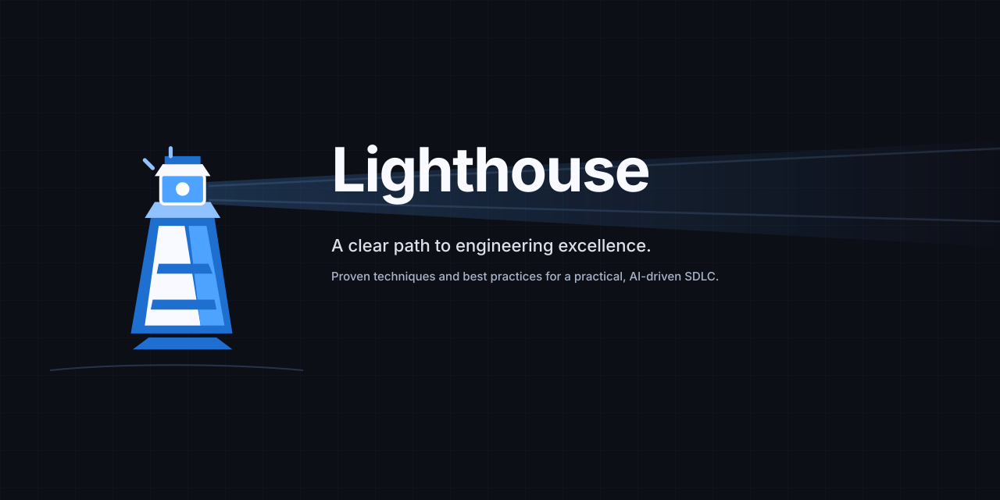

# Lighthouse

[](https://juangcarmona.github.io/lighthouse/)

Lighthouse is a reusable engineering baseline with package-owned guidance, profiles and deterministic checks.

## Explore

- [Public site](https://juangcarmona.github.io/lighthouse/)
- [Product snapshot](https://juangcarmona.github.io/lighthouse/model/)
- [Architecture snapshot](https://juangcarmona.github.io/lighthouse/architecture/)
- [Harness package guide](src/packages/cli/README.md)

ProductShape owns product intent, ArcShape owns architecture evidence and Lighthouse owns the delivery baseline.

## Develop

Requires Node.js 22 and the .NET SDK for backend profile work.

```sh
npm ci --ignore-scripts
npm run verify
```

Build the public site locally with `npm run build:public-site`; preview it with `npm run preview:public-site`.
