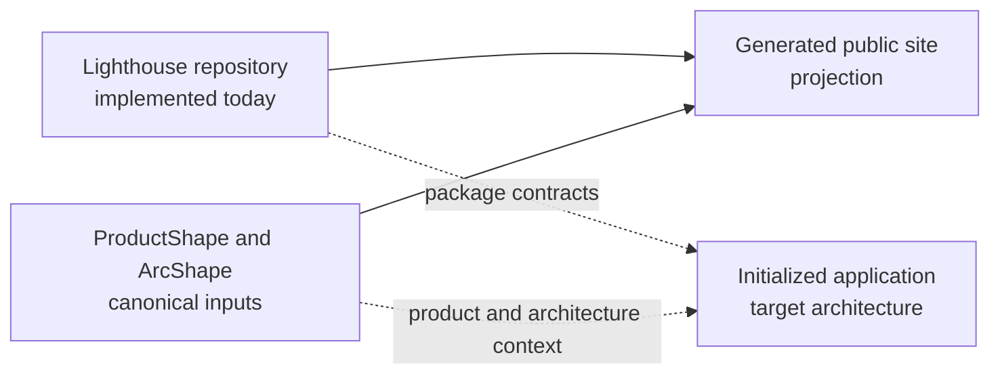

# 1. Introduction and goals

## Requirements overview

Lighthouse is a project-owned engineering baseline that distributes a harness, profiles, guidance and deterministic checks through an initialization route.

The current repository contains the Node/npm workspace, the Lighthouse CLI, the independent UI package, a .NET reference profile, verification scripts, a browser gallery and a static public site.

The target product adds profile-aware initialization: every initialized project receives a predictable repository structure and Aspire as its composition boundary, while application-specific capabilities are selected through profiles.

The target full-stack profile provides a feature-aligned modular monolith when the adopter selects a Lighthouse-owned backend; frontend-only applications and requested microservices receive only the selected capabilities.

The target is defined by the applied [CHG-INITIAL product change](../../product/changes/completed/chg-initial/change.md) and is not implemented in full by the current CLI.

## Architecture viewpoints

The public story joins two views without treating them as the same system: the current checkout is the implementation evidence, while the target application is the architecture that the packages are intended to generate.

## Quality goals

- **Predictable adoption:** an initialized repository has a known structure and a clear first action.
- **Profile fit:** guidance and checks match the selected application shape and stack.
- **Feature traceability:** full-stack features map clearly between frontend, backend modules and bounded-context evidence.
- **Deterministic verification:** hard guardrails fail with reproducible, actionable evidence.
- **Low maintenance:** each fact has one owner and generated projections do not become new authorities.

## Stakeholders

| Stakeholder | Interest | Responsibility |
| --- | --- | --- |
| Lighthouse maintainer | A reusable baseline that remains small and useful | Owns source, package contracts and checks |
| Adopting project | A suitable starting structure and local verification | Owns product code, configuration and exceptions |
| ProductShape | Product intent and product changes | Owns the product definition when adopted |
| ArcShape | Architecture evidence and reader documentation | Owns the architecture source when adopted |
| Agent or developer | Clear guidance, examples and failure evidence | Uses the project contract and reports gaps |
