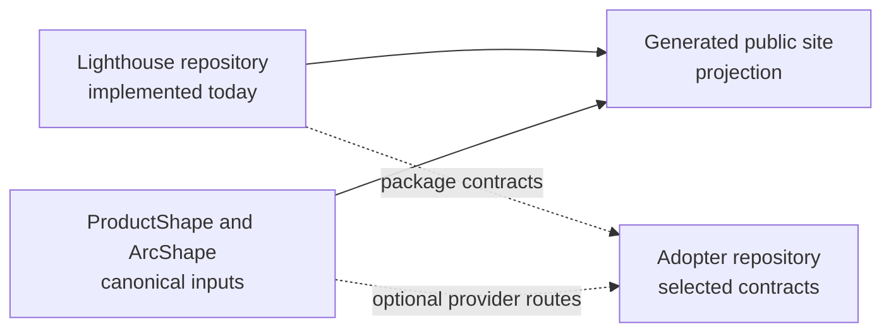

# 1. Introduction and goals

## Requirements overview

Lighthouse is a project-owned engineering baseline that distributes a CLI harness, an SDLC contract package, a UI package, technical profiles and deterministic checks through versioned package boundaries.

The current repository is the package authoring workspace. It contains the Node/npm workspace, the CLI, the independent UI and SDLC packages, profile assets, a .NET reference profile, verification scripts, a browser gallery and a static public site.

The CLI already initializes predictable repository roots, managed projections, local hooks, the SDLC control-plane projection and selected profile assets. It also supports semantic initialization plans, authority initialization or adoption, profile composition, upgrade planning, capability reconciliation and machine-readable verification.

The product model describes a broader application initializer that selects an application shape, configures Aspire, checks an external CodeGraph service and can seed a feature-aligned backend. Those parts remain target behavior; the current CLI does not create an Aspire application or run CodeGraph.

The product-dependent statements in this section are grounded in the current ProductShape model. The model validates with zero errors and warnings, but its artifacts remain marked `draft` and therefore describe intent rather than an accepted product baseline.

<!-- pdac:cite id="UC-INITIALIZE-PROJECT" digest="sha256:10a0edc89444b645253a801fb3bf35dc8c3bcf858396e50de2057091c4d8f7fa" -->

## Architecture viewpoints

The public story joins two views without treating them as the same system: the current checkout is the implementation evidence, while an adopter repository is a consumer of the package contracts. ProductShape supplies intent and ArcShape supplies architecture documentation; Lighthouse integrates their routes without becoming either authority.

## Quality goals

- Predictable adoption: a consumer can inspect a plan, apply owned projections and reach a first verification result.
- Ownership safety: package updates and authority integrations preserve project-owned and provider-owned files.
- Deterministic evidence: verification, profile composition and capability plans expose explicit statuses and next actions.
- Reproducible distribution: package contents and the public site are checked from the source workspace.
- Low coupling: ProductShape, ArcShape, OpenSpec, the SDLC package and adopter infrastructure retain separate ownership.

<!-- pdac:cite id="QR-ADOPTABILITY" digest="sha256:97827599b046672b59f27be39008c158d043d8c11a8f54cf9dd9b1478b1d6e55" -->

## Stakeholders

| Stakeholder | Interest | Responsibility |
| --- | --- | --- |
| Lighthouse maintainer | A reusable baseline that remains small and useful | Owns source, package contracts and checks |
| Adopting project | A suitable starting structure and local verification | Owns product code, configuration and exceptions |
| ProductShape | Product intent and product changes | Owns the product definition when adopted |
| ArcShape | Architecture evidence and reader documentation | Owns the architecture source when adopted |
| Agent host or developer | Package contracts, guidance and failure evidence | Executes or consumes the routes and reports gaps |
