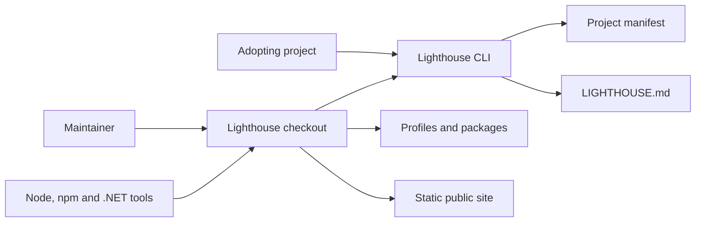

# 3. System scope and context

## System context

The checkout is the system boundary. The CLI reads a project manifest and writes the managed `LIGHTHOUSE.md` projection in a consuming repository. The theme, components and CLI packages are local npm artifacts. The Lighthouse .NET profile is source and test material in this repository.

ProductShape, ArcShape and OpenSpec appear in the workspace for repository authoring. They are not called by the current Lighthouse CLI.

## External boundaries

| External system | Current interaction | Owner |
| --- | --- | --- |
| Node and npm | Install workspace dependencies and run scripts | Project toolchain |
| .NET SDK | Build and test the Lighthouse .NET profile | Lighthouse .NET profile and consuming project |
| ProductShape | Author and validate product artifacts | ProductShape |
| ArcShape | Author and validate architecture artifacts | ArcShape |
| OpenSpec | Provide change schemas in the repository | OpenSpec |
| Cloudflare Pages | Optional static hosting for `dist/public-site/` | Site operator |
