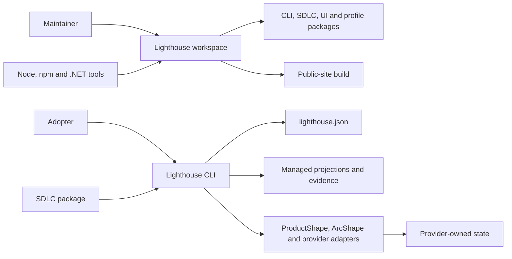

# 3. System scope and context

## System context

The current system boundary is the Lighthouse workspace plus the package contracts it emits. In a consuming repository, the CLI reads `lighthouse.json`, loads installed package assets, plans owned changes and writes only declared Lighthouse-managed paths. Provider-owned paths and remote state remain outside the Lighthouse boundary.

<!-- pdac:cite id="BR-OWNED-AUTHORITY" digest="sha256:927ca94ef20deb83a84734978c82c5647cd1cd41eeaed9935eda7f4a6c61f611" -->

## External interfaces

| External system | Current interaction | Boundary owner |
| --- | --- | --- |
| Node and npm | Install packages and run CLI, tests and site scripts | Project toolchain |
| .NET SDK | Build and verify the reference profile and generated .NET starter | .NET profile or adopter |
| ProductShape | Validate product files and initialize or adopt `docs/product/model/` | ProductShape |
| ArcShape | Validate, link-check and render `docs/architecture/` | ArcShape |
| OpenSpec | Own change schemas and managed change files | OpenSpec |
| GitHub CLI and provider | Read or explicitly mutate labels, issues and child issues through SDLC adapters | Provider |
| GitHub Pages | Host the verified static site output | Site operator |

The product-defined CodeGraph MCP and Aspire application boundary are planned adopter integrations. No CodeGraph client or Lighthouse-hosted application runtime is present in this repository.

## Delivery authorities

| Concern | Single owner | Consumers and projections |
| --- | --- | --- |
| Product intent | Each product's ProductShape model | Architecture, work items and stage context cite it. |
| Architecture and durable decisions | Each repository's ArcShape documents and ADRs | Plans and workers read them. |
| Baseline, profiles and managed adoption | Lighthouse CLI and owning profile packages | Installed repository files retain version and ownership evidence. |
| Stage semantics, routes, gates and result schemas | Lighthouse SDLC package | GitHub workflows and host adapters consume the exact installed contract. |
| Issues, source commits, PRs and check observations | GitHub | Local state stores source identity, revision and observation time. |
| Runtime admission, leases, recovery and fleet capacity | Adopter's factory, such as SoFa | Repository jobs submit scoped requests and receive operational results. |
| Agent execution and inference | Selected engine and model provider | The factory supervises execution; stage names grant no provider credentials. |
| Approval and autonomy policy | Named adopter authority | Machines evaluate the recorded policy and retain attributable decisions. |

<!-- pdac:cite id="BR-OWNED-AUTHORITY" digest="sha256:927ca94ef20deb83a84734978c82c5647cd1cd41eeaed9935eda7f4a6c61f611" -->

Lighthouse can be installed and verified without a factory process. A factory consumes its contract without importing Lighthouse's repository layout or replacing its product authorities. [ADR-0007](../09-architecture-decisions/0007-host-execution-boundary.md) defines the accepted execution/publication seam; [the roadmap](../../roadmap/factory-reconciliation.md) records the current gaps.
