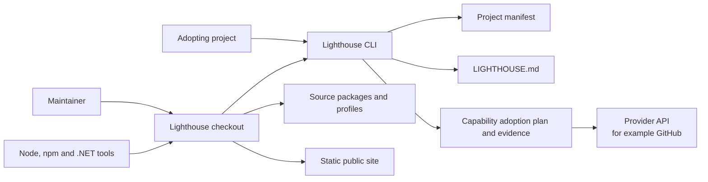
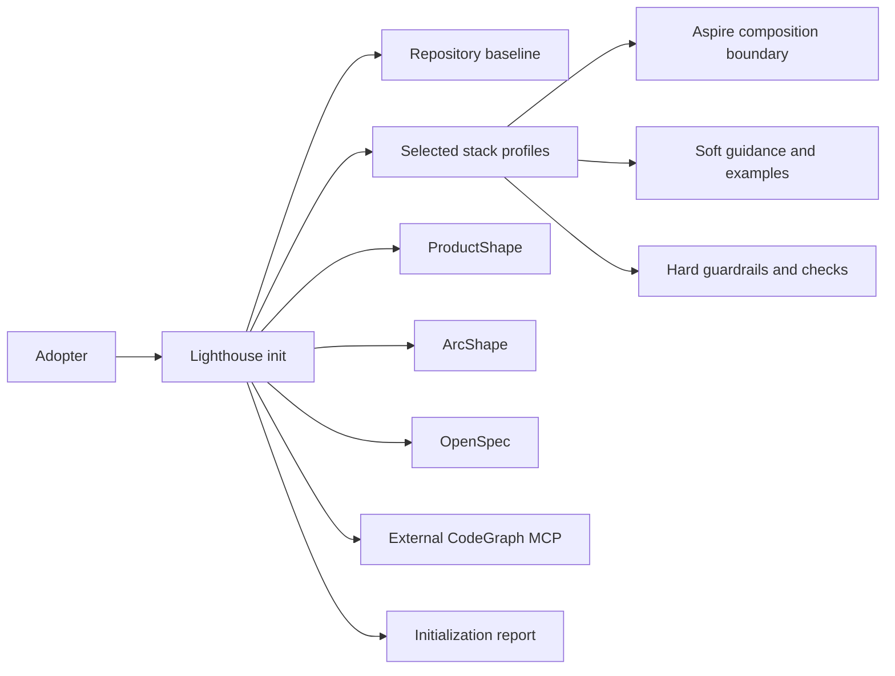

# 3. System scope and context

## Current system context

The current checkout is the implemented system boundary. The CLI reads a project manifest and writes the managed `LIGHTHOUSE.md` projection in a consuming repository.

## Target initialization context

The following context describes the product-defined initializer and its external authorities; it is a target view until the corresponding implementation is delivered.

Lighthouse coordinates adoption and leaves product intent, architecture evidence, change artifacts and repository indexing with their owning tools or services.

## External boundaries

| External system | Current or target interaction | Owner |
| --- | --- | --- |
| Node and npm | Install workspace dependencies and run scripts | Project toolchain |
| .NET SDK | Build and verify the .NET reference profile and selected adopters | .NET profile or adopter |
| Aspire | Compose and run initialized application services | Initialized application |
| ProductShape | Author and validate product artifacts | ProductShape |
| ArcShape | Author, validate and render architecture artifacts | ArcShape |
| OpenSpec | Provide change schemas and change files | OpenSpec |
| CodeGraph MCP | Index repository and worktree context outside the checkout | External service |
| Capability provider | Supply and verify provider-owned state after explicit authorization | Provider, for example GitHub |
| GitHub Pages | Static hosting for the verified public-site output | Site operator |
