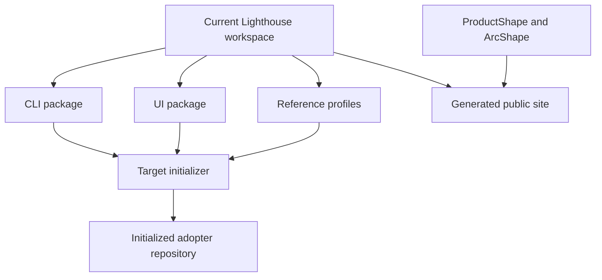

# 4. Solution strategy

## One baseline with bounded profiles

Lighthouse keeps a small baseline for repository structure, authorities, managed projections and verification, then composes application profiles that own their templates, guidance and checks.

Initialization selects profiles from the application shape and requested stacks; it does not install a backend or a stack-specific rule set that the adopter did not select.

## Aspire as composition boundary

Every initialized application receives an Aspire composition boundary, including frontend-only applications. Aspire provides the application host and local composition; the selected profiles decide which services participate.

## Feature-aligned modular monolith

When Lighthouse owns a backend, the default full-stack profile uses a modular monolith organized around bounded contexts and vertical feature slices.

The frontend mirrors the feature vocabulary needed by the backend so that a feature can be traced from user interaction through API boundary, application handler, domain behavior, persistence and tests.

The profile applies red-green development, starts with unit tests, adds integration and other applicable layers, and records end-to-end evidence by bounded context.

## Selective service and stack profiles

A requested microservice receives a service profile with only its relevant host, contracts, checks and guidance.

Python and other stacks receive profiles that define their own dependency, formatting, typing, testing, packaging and CI practices.

## Package ownership

The current workspace keeps the CLI and UI as separate packages. Profile assets may remain distributed by the Lighthouse installer until a profile needs an independent release or installation boundary.

## Current repository versus target output

The current repository is the package authoring workspace. The target is the adopter repository produced by the selected baseline and profiles. The public site is a generated explanation of both views, not another authority.

## Authority boundaries

ProductShape owns product intent, ArcShape owns architecture documentation and OpenSpec owns change artifacts. Lighthouse integrates their supported routes and does not create replacement authorities.
