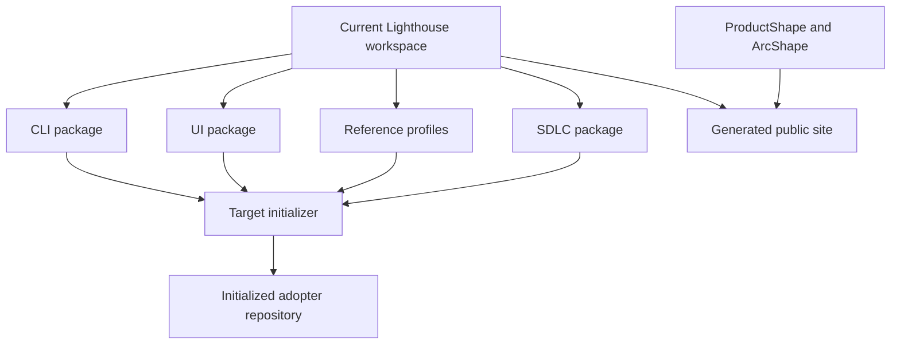

# 4. Solution strategy

## Package boundaries with data-driven composition

Lighthouse keeps a small baseline for repository structure, authorities, managed projections and verification. The CLI, SDLC and UI contracts are independent packages, while profile and guardrail catalogs describe composition without requiring a new CLI branch for each entry.

The CLI composes selected profiles from `application.shape`, `application.stacks` and the profile catalog. It reports missing prerequisites, incompatibilities and unconfigured choices before writing profile-owned paths.

## Dry-run, explicit mutation and recorded ownership

Initialization, reconciliation, upgrade planning and authority adoption are previewable. External provider writes require an explicit apply route; capability adoption additionally requires the plan hash. Managed projections carry hashes in `.lighthouse/upgrade.json`, so customized or unowned content is preserved or blocked.

## Provider-owned authorities

ProductShape, ArcShape and OpenSpec retain their own files and validators. Greenfield authority initialization delegates to the provider CLIs; brownfield adoption runs provider validators read-only and records exact versions only in `lighthouse.json`.

<!-- pdac:cite id="UC-INITIALIZE-AUTHORITIES" digest="sha256:7243c8af149a2199dd2e9e9f9984a6b7a72de8d98b24917af07fa40861058a51" -->

## Explicit evidence states

The verifier preserves the distinction between `passed`, `failed`, `drift`, `unavailable`, `unconfigured`, `pending-review` and `not-applicable`. Required guardrails pass only with `passed` or `not-applicable`; semantic and human checks remain visible until their evidence exists.

<!-- pdac:cite id="UC-VERIFY-FOUNDATION" digest="sha256:353ac93b2889f277883d867ae98be244fbf8a00e8bc0bba5a6b2d594eaa21d11" -->

## Target application strategy

The product model still describes Aspire as the composition boundary for an initialized application and a feature-aligned modular monolith when Lighthouse owns a backend. The current repository contains the .NET profile and an Aspire example, but the CLI does not generate that application topology. This remains a profile delivery concern for a future adopter integration.

<!-- pdac:cite id="FR-INITIALIZE-FOUNDATION" digest="sha256:95dfc4b2b0a94c5747615e734a2302004543bcc8f33e1e494937d471d2bfc1c4" -->

## Authority boundaries

ProductShape owns product intent, ArcShape owns architecture documentation and OpenSpec owns change artifacts. Lighthouse integrates supported routes and does not create replacement authorities.
