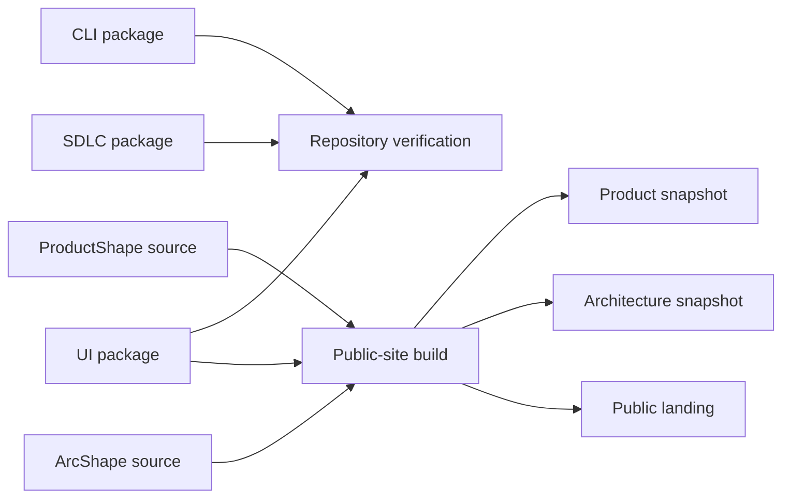
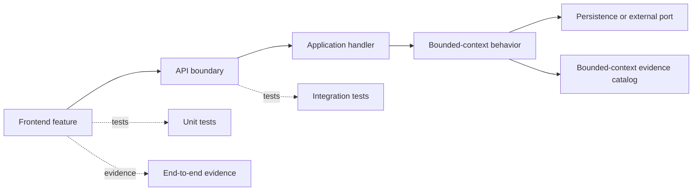

# 5. Building block view

## Current Lighthouse workspace

| Building block | Source | Responsibility |
| --- | --- | --- |
| CLI package | `src/packages/cli/` | Initialize the baseline, record the selected SDLC package and verify generated projections |
| SDLC package | `src/packages/sdlc/` | Distribute lifecycle skills, commands, meta-commands, route and gate contracts and deterministic package checks |
| UI package | `src/packages/ui/` | Export semantic tokens, native recipes and `DESIGN.md` |
| .NET reference profile | `src/dotnet/` | Demonstrate modular monolith, CQRS/VSA, Aspire and Roslyn checks |
| Gallery | `src/gallery/` | Exercise the UI package in a browser |
| Public site | `src/public-site/` and `scripts/build-public-site.mjs` | Present the current Lighthouse story and publish ProductShape and ArcShape snapshots |
| Repository checks | `src/tests/` and `scripts/` | Verify package, link, adoption and site contracts |
| Product and architecture sources | `docs/product/` and `docs/architecture/` | Keep ProductShape and ArcShape sources reviewable |

## Target initialized application

The product-defined initializer composes the following blocks only when their profile is selected.

| Profile block | Responsibility |
| --- | --- |
| Repository baseline | Provide `src/`, `docs/`, automation and integration entrypoints |
| SDLC package and control plane | Provide lifecycle assets and record selected routes, gates, state, memory and adapters under `.lighthouse/` |
| Aspire AppHost | Compose and run the selected application services |
| Frontend feature areas | Implement user-facing features using the shared visual contract |
| Backend bounded contexts | Keep domain, application, contracts, infrastructure and tests aligned by feature |
| Service profile | Supply a selected microservice without creating the default backend |
| Stack profile | Supply language-specific conventions, examples and checks |
| Evidence catalog | Associate integration and end-to-end evidence with bounded contexts |

The target profile blocks are product decisions and templates. The current CLI projects the baseline and SDLC control plane; lifecycle execution remains a host-specific integration.

## Feature mapping

