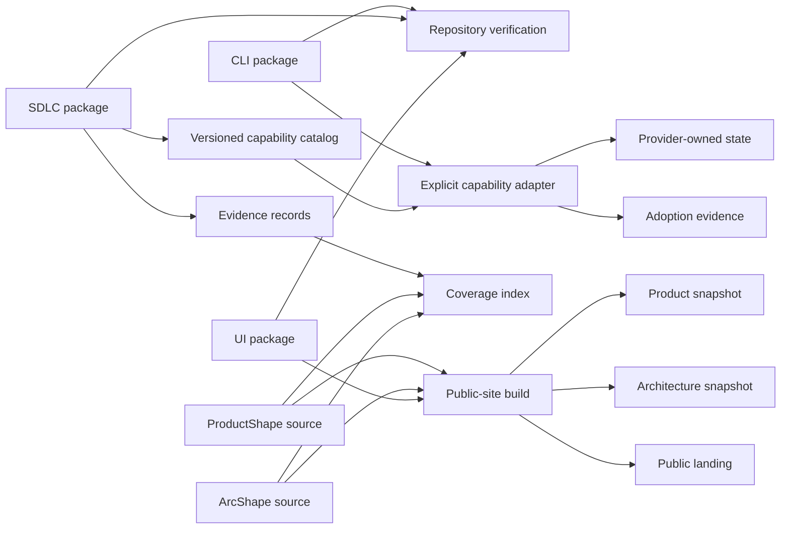
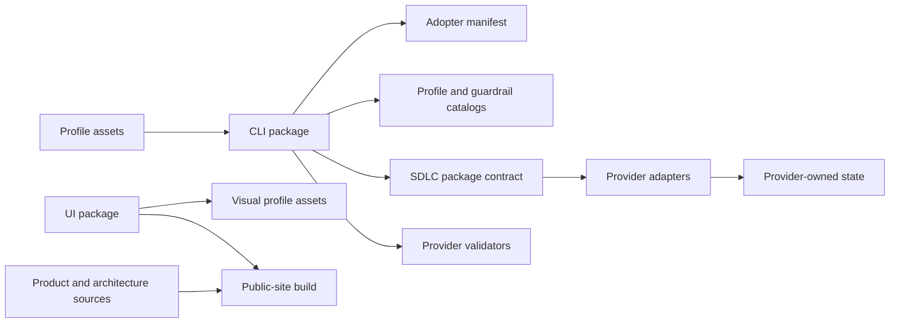

# 5. Building block view

## Whitebox overall system

The Lighthouse workspace has a package authoring side and an adopter contract side. The authoring side contains source, profiles, tests and site tooling. The CLI projects the selected contract into a consuming repository; the SDLC package supplies lifecycle contracts that an agent host may execute.

| Building block | Source | Responsibility |
| --- | --- | --- |
| CLI package | `src/packages/cli/` | Initialize and verify adopter foundations, compose profiles, create the .NET starter, adopt authorities and plan upgrades |
| SDLC package | `src/packages/sdlc/` | Distribute lifecycle skills, commands, routes, gates, schemas, deterministic planning and provider adapters |
| UI package | `src/packages/ui/` | Export semantic tokens, native recipes and `DESIGN.md` |
| Profile assets | `src/packages/cli/assets/profiles/` | Declare application applicability, owned surfaces, prerequisites, checks and repair hints |
| .NET reference profile | `src/dotnet/` and `src/packages/cli/assets/dotnet-template/` | Demonstrate and distribute the modular monolith, CQRS/VSA, Aspire and Roslyn checks |
| Gallery | `src/gallery/` | Exercise the UI package in a browser |
| Public site | `src/public-site/` and `scripts/build-public-site.mjs` | Present the current Lighthouse story and publish ProductShape and ArcShape snapshots |
| Repository checks | `src/tests/` and `scripts/` | Verify package, link, adoption and site contracts |
| Capability adoption boundary | `src/packages/sdlc/src/capabilities.mjs`, `src/packages/sdlc/src/reconcile.mjs` and CLI capability commands | Validate the package catalog, plan provider changes, require authorization and record evidence |
| Evidence contract boundary | `src/packages/sdlc/src/evidence.mjs`, evidence schemas and CLI verification | Adapt producer results into neutral records and build coverage indexes without owning ProductShape or ArcShape |
| Profile catalog | `src/packages/cli/assets/profiles/` and `src/packages/cli/src/profiles.mjs` | Describe application applicability, owned surfaces and verification layers without adding runtime behavior |
| Product and architecture sources | `docs/product/` and `docs/architecture/` | Keep ProductShape and ArcShape sources reviewable |

## Important interfaces

The CLI's important interfaces are the manifest and managed paths in an adopter, the package catalogs and schemas, the ProductShape and ArcShape provider commands, and the optional GitHub adapter exposed by the SDLC package. The source locations above are evidence links; the source code remains authoritative for exact fields and file lists.

| Interface | Direction | Contract |
| --- | --- | --- |
| CLI to adopter | writes | `lighthouse.json`, `LIGHTHOUSE.md`, `.lighthouse/`, hooks, workflows and selected profile paths |
| CLI to authorities | invokes | Provider-owned initialization or read-only validation commands |
| CLI to capability provider | reads then explicitly writes | Provider adapter plan, authorization hash and adoption evidence |
| Agent host to SDLC package | reads and validates | Skills, commands, route/gate descriptors and provider-neutral schemas |
| Producers to evidence contract | writes locally | Stage, browser and future profile results adapted into evidence records; source payloads remain producer-owned |
| Evidence index to authorities | reads references | ProductShape and ArcShape identifiers, revisions, paths and hashes; no authority mutation |

## Dependency direction

## Workflow projection and proposed host adapter

The [workflow sources](../../../src/packages/sdlc/workflows/) distribute an opt-in event router and a compiled gh-aw refinement worker with an imported OpenCode engine. The installer selects only this working route; other stage templates remain reference assets. The engine adapter starts a temporary container in the Actions job and streams its output. Separate preparation and publication jobs hold GitHub write credentials. Lighthouse has no persistent execution server.

Under accepted [ADR-0007](../09-architecture-decisions/0007-host-execution-boundary.md), the SDLC package additionally owns execution-request validation and stage-effect validation. The GitHub projection resolves these from the installed package and invokes an adopter-provided host adapter. The host owns process supervision and a privileged publication service; the publisher consumes Lighthouse validation rather than inventing stage semantics. No host SDK or plugin framework is required for the first consumer.

<!-- pdac:cite id="UC-RUN-AGENT" digest="sha256:a36f45b77cc1a28f6222e3becc70832fc60e70f6857d36d0870154165d28c42e" -->
