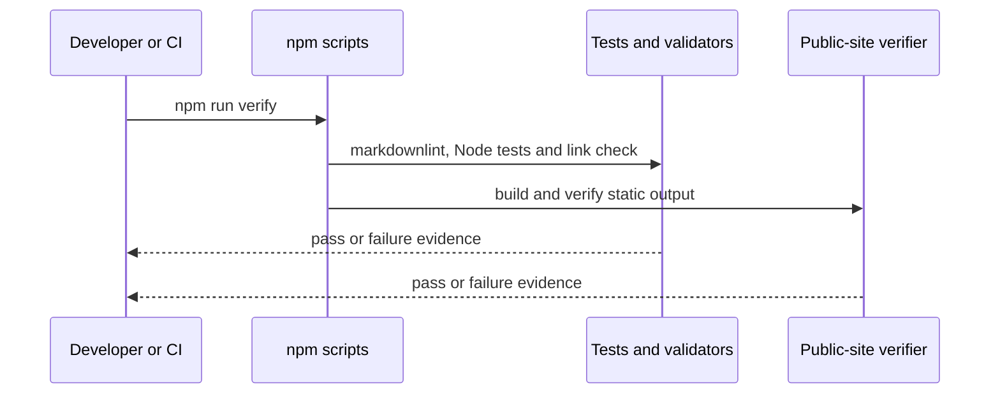

# 6. Runtime view

## Verify the repository

`npm run verify` runs Markdown linting, Node tests, local link checks and public-site verification. `npm run verify:dotnet` runs the backend profile. `npm run test:visual` runs the gallery browser checks.

## Initialize a consuming project

1. A consuming project provides `lighthouse.json`.
2. `lighthouse init` validates the manifest and creates `LIGHTHOUSE.md`.
3. `lighthouse verify` compares the projection with the manifest and fails on drift.

The CLI refuses to overwrite an existing projection. It does not initialize ProductShape, ArcShape, OpenSpec, a tracker or an agent runtime.
