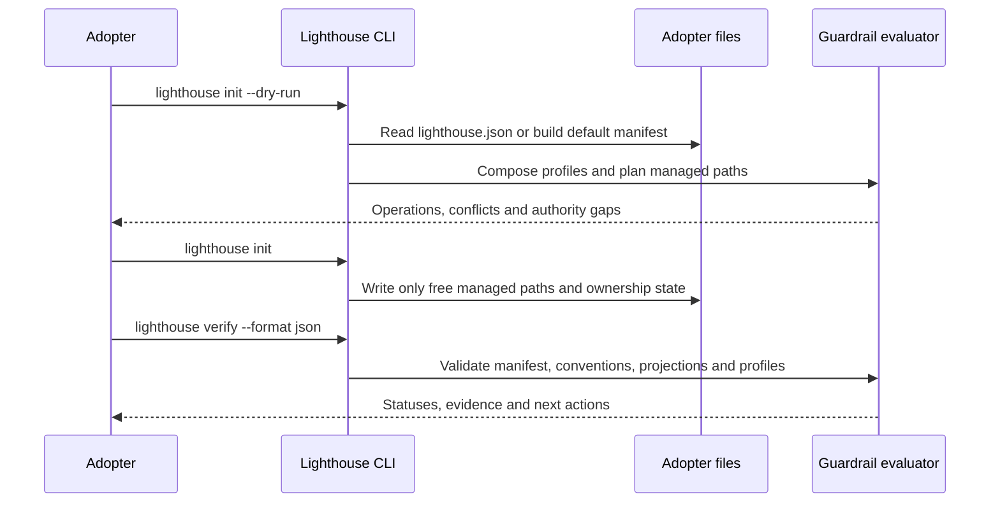
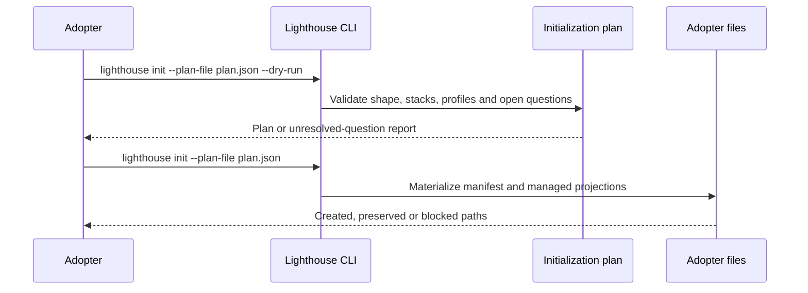
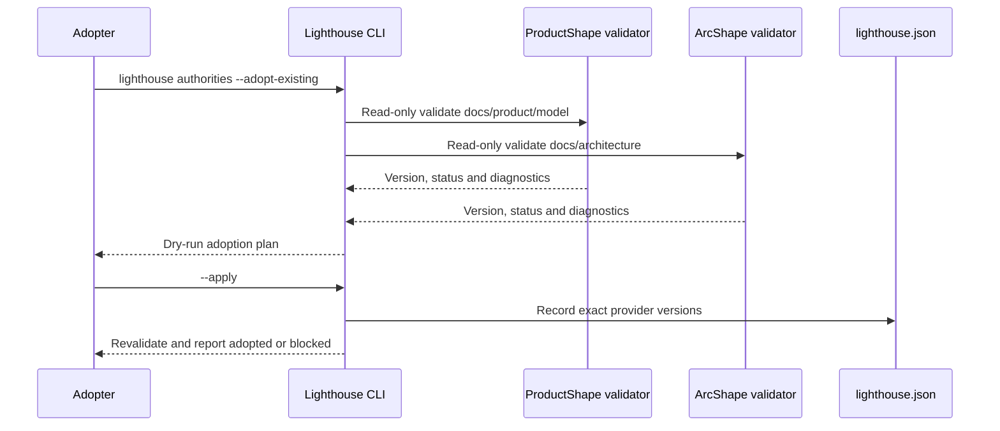
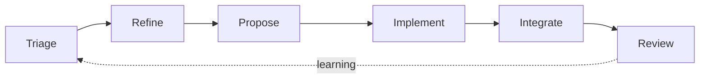
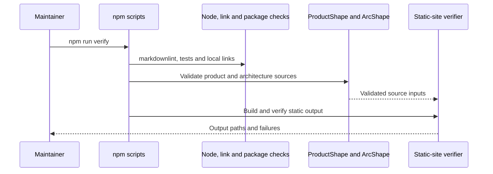
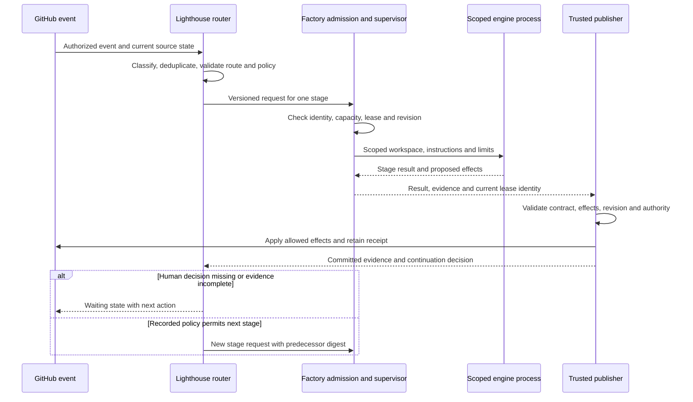
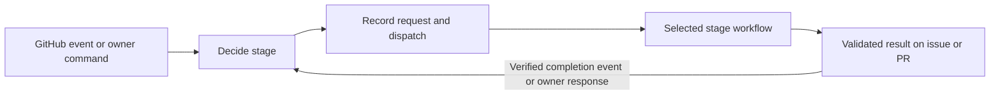

# 6. Runtime view

## Initialize and verify an adopter

The repository also exposes `npm run verify`, `npm run verify:dotnet` and `npm run test:visual` for workspace, .NET and browser evidence respectively.

## Semantic initialization

The current CLI executes this plan for the baseline and selected profile assets. Aspire application creation and external CodeGraph checks remain outside this runtime.

## Adopt existing authorities

Existing-authority adoption leaves provider-owned files unchanged. The same boundary applies to capability adoption: the package owns the catalog and adapter contract, the CLI owns local declaration and evidence, and the provider remains the authority for remote state.

<!-- pdac:cite id="UC-INITIALIZE-AUTHORITIES" digest="sha256:7243c8af149a2199dd2e9e9f9984a6b7a72de8d98b24917af07fa40861058a51" -->

## SDLC route planning

The SDLC package implements route, stage, gate, state, decomposition and provider-adapter validators. It also distributes gh-aw workflows that execute an agent in GitHub Actions. Lighthouse has no persistent execution service. The selected router handles owner refinement labels, clarification replies and manual dispatch. Later-stage composition remains outside this implemented route.

## Verify package and site contracts

## Target supervised host execution

This is the accepted target implementation of the bounded-role use case, not the current gh-aw execution path. The agent supplies candidate results; a deterministic validator interprets them and a separately credentialed publisher performs effects. Automated triage/refine may gather information and prepare artifacts while a required human gate prevents the next stage. Unattended progression requires an accepted policy for the named gate; setting `composition: ff` alone grants none.

<!-- pdac:cite id="UC-RUN-AGENT" digest="sha256:a36f45b77cc1a28f6222e3becc70832fc60e70f6857d36d0870154165d28c42e" -->

### Request and result boundary

The following is a design contract pending a packaged schema and compatibility tests. The SDLC package owns its wire shape; the host owns its operational result. Do not place these fields into `stage-result` v1, which remains unchanged.

| Request content | Validation and owner |
| --- | --- |
| Schema and package versions, contract digest | Adapter resolves exact installed artifacts; unsupported combinations stop before model use. |
| Repository ID, work-item reference, source and workflow revisions | Trusted ingress supplies identity; publisher rereads remote source before writing. |
| Delivery run ID, stage execution ID, attempt ID and idempotency key | Stable identities correlate events, retries and artifacts; duplicate submission returns the existing attempt. |
| Route, stage, role, predecessor result digests | Lighthouse validates membership, order, stage/gate pairing and predecessor lineage. |
| Authority references, tool capabilities, write scope and proposed effect types | Versioned role and adopter policy bound the request; the host may only narrow it. |
| Deadline, correction/recovery bounds and cancellation reference | Host enforces process/resource limits and stops on exhausted authority. |
| Policy revision and recorded approval references | Publisher verifies scope, actor and freshness; changed source or policy invalidates affected approvals. |

The response contains a separate operational outcome, the candidate stage result, proposed effects and evidence references. `completed` at the process boundary does not imply `passed` at the stage boundary. An interrupted run may have no stage result and still needs a durable operational record.

### Continuation and event handling

Continuation requires the expected run/stage/gate, successful stage status, complete required evidence, no unresolved blocker and the gate decisions required by the selected route. `ready` is preparation, not approval. The validator checks evidence content and provenance as well as JSON shape. The router must not use a model's `nextAction` as an executable command.

The event adapter rereads issue state and actor permission before admission and publication. It accepts at most one stage request for an event identity and ignores closed, duplicate, unauthorized or irrelevant events. Issue comments are task data, never workflow code. An answered clarification resumes only the matching waiting run with a fresh revision and bounded round count.

Persist validated transition events with correlation and source references. Rebuild lifecycle state using Lighthouse's transition rules; derive labels from that state and verify provider writes. The host stores those events without creating a different transition catalog.

<!-- pdac:cite id="BR-WORKFLOW-STATE" digest="sha256:d438b58d35667a01f2d0121554dc57681df8cd1f48d3eba07c0ee9b23035f1b8" -->

GitHub label writes made with `GITHUB_TOKEN` do not trigger another issue-label workflow. Use explicit reusable-workflow composition or an authorized dispatch for continuation, or a separately configured GitHub App when its event behavior is required. PR CI trigger/approval behavior must be tested with the actual publisher identity; a successful push is not evidence that required CI ran. See [GitHub workflow triggering](https://docs.github.com/en/actions/how-tos/write-workflows/choose-when-workflows-run/trigger-a-workflow).

## Implemented direct refinement

The external-host projection accepts an owner-added `refine` label. The host authenticates event facts and invokes the package's deterministic event router; schema-2 admission carries the verified label-event identity without a triage predecessor. Schema 1 preserves the prior supervised contract. Source remains read-only and the stage publishes a validated refinement comment plus its readiness labels. See the [packaged host contract](../../../src/packages/sdlc/host-contract.md).

The host owns the persistent reservation and projects it as `agent-working`. `human-working` prevents new agent admission and requests termination of active work. Outcome publication and reservation cleanup must finish before capacity is released. Labels are cooperative signals; they cannot prevent a human or an unrelated tool from editing the issue.

## Repository-owned gh-aw refinement

An owner event reaches one router and one independently dispatched gh-aw worker. A preparation job verifies identity and current source, snapshots issue intent and reserves the issue. The agent job loads the pinned harness package and starts OpenCode in a temporary Docker container. Source and skills are read-only; the candidate envelope is writable. The imported engine streams OpenCode events into the Actions step and gh-aw log artifacts.

A separate publication job validates the envelope and rereads source, owner answers and reservation before commenting and setting `ready` or `needs-info`. Cleanup releases `agent-working`. An owner reply resumes the waiting stage. The installed implementation policy may continue a passed refinement; merge still needs its existing owner decision.

The Actions run owns the execution record, with source/harness/image revisions in a runtime receipt. There is no socket service or SoFa execution dependency. The earlier external-host contract remains available for compatibility. The [engine deployment example](../../../src/examples/opencode-engine/README.md) states the Docker subscription profile's isolation limits; the broader continuation contract above remains target behavior.

## Independent stage dispatch

The router decides and dispatches; each installed stage executes independently. A receipt on the issue links the originating router to the claimed worker. The original event is retained in an immutable Actions artifact. Admission authenticates that chain and rechecks current source, issue intent and stage-specific approvals before starting the agent. Short dispatch jobs and worker executions use separate concurrency groups; workers share the issue group across stages.

Successful refinement can hand off to implementation under the installed policy. `future`, missing evidence and human decisions still stop continuation. CI completion and owner PR reviews retain the existing completion authorization. Automatic continuation identifies the completed source run so repeated notifications do not create another stage execution. The operator can replay a completion through the same checks for acceptance; replay does not bypass a gate.

A lost response remains unconfirmed and prevents automatic resend. A claimed request cannot start a second agent. The receipt's icon and phase describe the last host observation; Actions remains authoritative for current execution status, including interrupted cleanup. Temporary request artifacts are needed for new admission. Published integration evidence retains its authenticated dispatch origin in the protected process record for later review. No database or SoFa process participates in execution.

See the [operator recovery boundary](../../../src/packages/sdlc/README.md#implementation-delivery) and the [original implementation acceptance record](implementation-dispatch-poc.md).

See the [worker catalogue](worker-catalogue.md) for source-linked routes, per-worker diagrams and operator actions.
