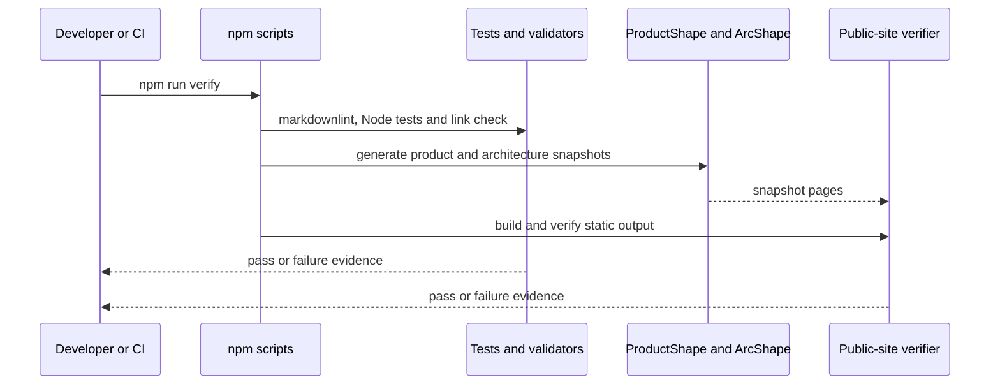
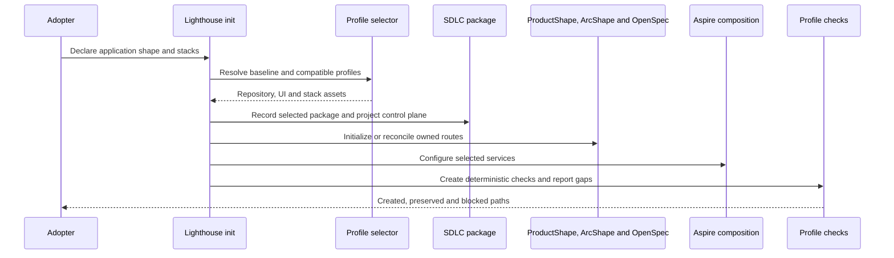
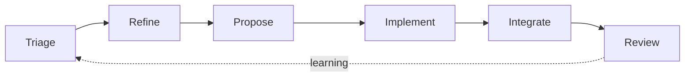
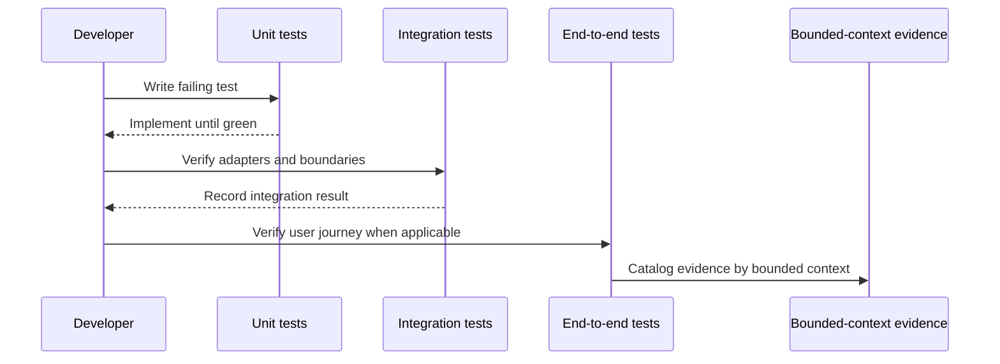

# 6. Runtime view

## Verify the current repository

The current repository also exposes `npm run verify:dotnet` for the .NET reference profile and `npm run test:visual` for the browser gallery.

## Initialize a target project

The current CLI executes the baseline and SDLC projection; profile selection, provider initialization and lifecycle execution remain separate integrations.

## Target delivery flow

The stages describe the target SDLC package. Labels expose the current handoff or route request, while ProductShape, ArcShape and verification evidence remain the authorities for their own content.

## Build and test a feature

