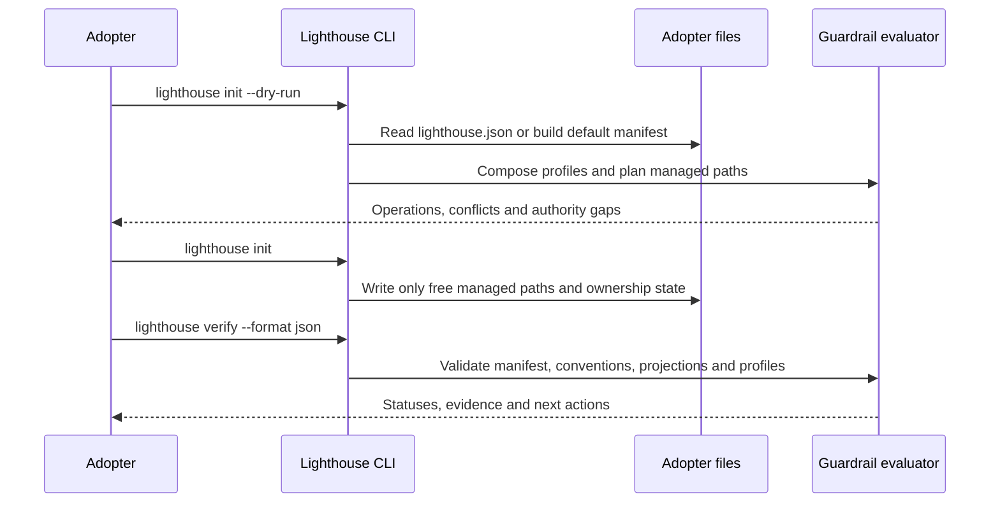
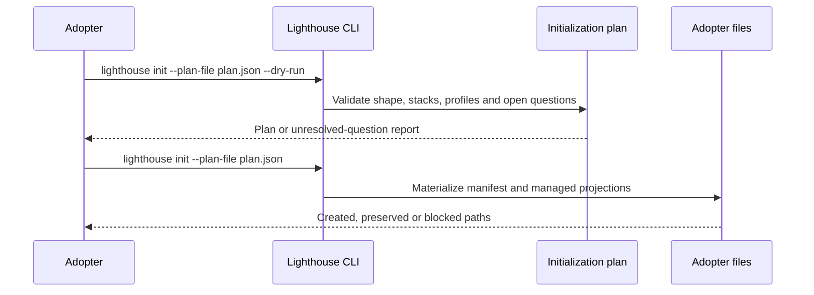
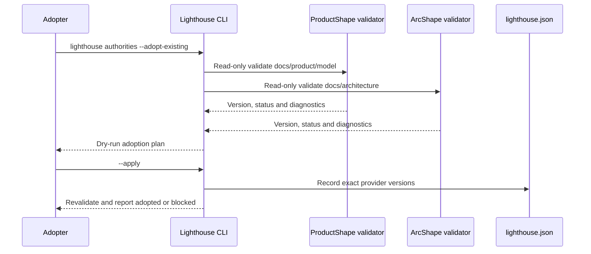
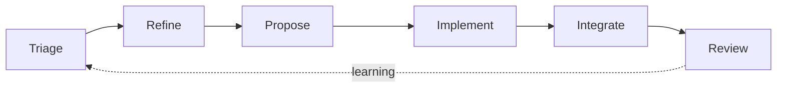
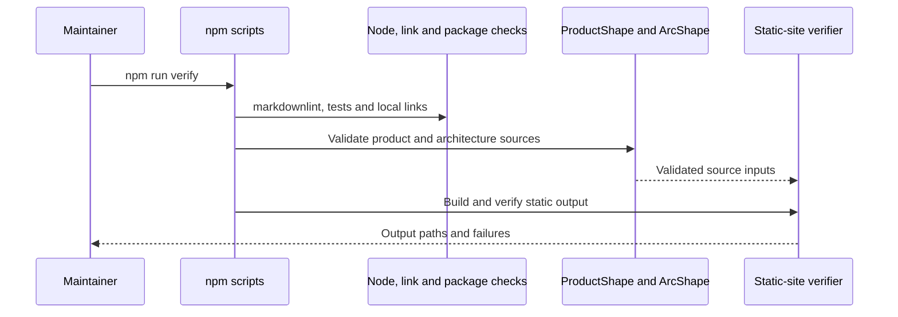

# 6. Runtime view

## Initialize and verify an adopter

The repository also exposes `npm run verify`, `npm run verify:dotnet` and `npm run test:visual` for workspace, .NET and browser evidence respectively.

## Semantic initialization

The current CLI executes this plan for the baseline and selected profile assets. Aspire application creation and external CodeGraph checks remain outside this runtime.

## Adopt existing authorities

Existing-authority adoption leaves provider-owned files unchanged. The same boundary applies to capability adoption: the package owns the catalog and adapter contract, the CLI owns local declaration and evidence, and the provider remains the authority for remote state.

<!-- pdac:cite id="UC-INITIALIZE-AUTHORITIES" digest="sha256:7243c8af149a2199dd2e9e9f9984a6b7a72de8d98b24917af07fa40861058a51" -->

## SDLC route planning

The SDLC package implements the route, stage, gate, state, decomposition and provider-adapter contracts as validators and projections. It does not execute agents or own a hosted delivery runtime.

## Verify package and site contracts

