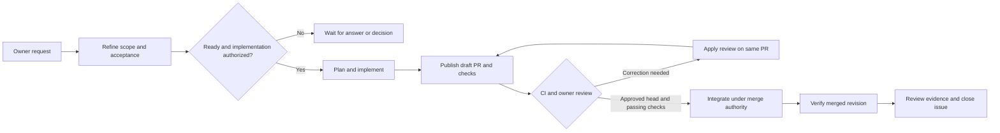
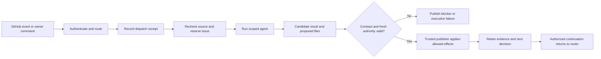
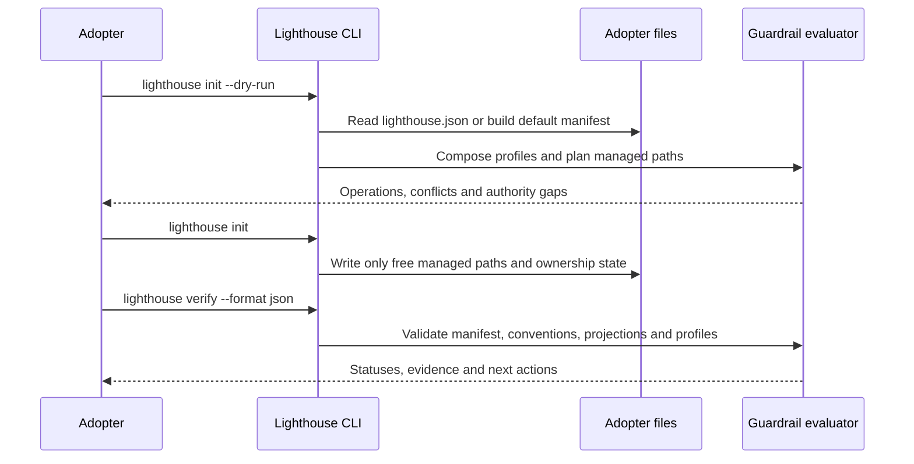
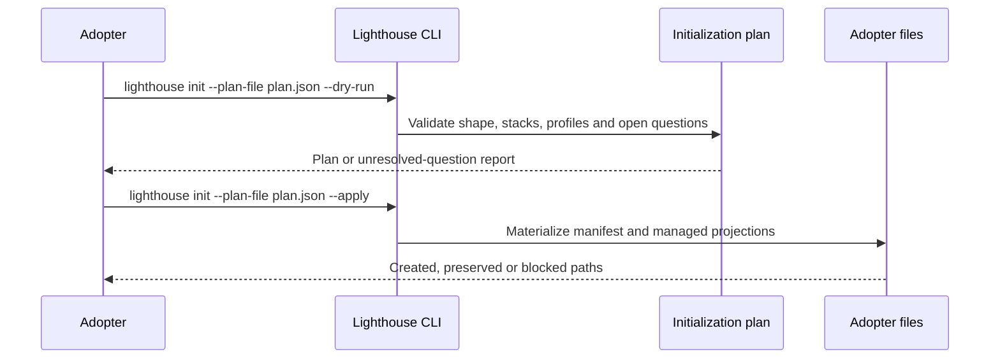
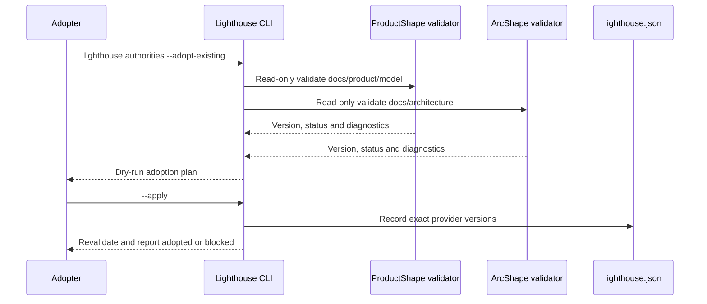
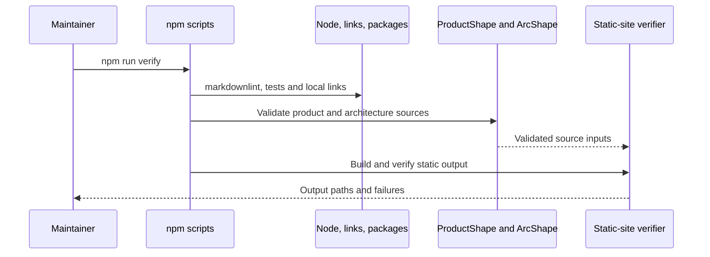

# 6. Runtime view

Lighthouse turns an authorized request into one bounded worker execution. GitHub Actions owns execution; ProductShape owns product meaning; the agent produces a candidate and a trusted publisher applies allowed effects. The diagrams below describe implemented routes. Installation, policy and current evidence determine which route can run in an adopter.

## Explore the flows

Start with [Product Definition as Code](product-definition-as-code.md), then follow the delivery map. Open a worker for its branches, stopping conditions and implementation evidence. The generated architecture reader lets you expand supported diagrams for inspection and presentation.

| Worker | Result |
| --- | --- |
| [Triage](triage.md) | An assessed request and provisional estimate; stops for an owner decision. |
| [Refine](refine.md) | Actionable scope and acceptance criteria, or a question. |
| [Propose](propose.md) | An optional engineering-proposal PR awaiting review. |
| [Product Change](product-change.md) | A validated product proposal awaiting an explicit decision. |
| [Apply Product Change](apply-product-change.md) | The approved product delta on the issue branch, with its receipt. |
| [Implement](implement.md) | Plan and code in a draft PR, with verification evidence. |
| [Apply review](apply-review.md) | A corrected or revalidated candidate on the same PR. |
| [Integrate](integrate.md) | An integration assessment and, when separately authorized, a merge. |
| [Review](review.md) | A retained retrospective and closure when delivery evidence passes. |

The [worker catalogue](worker-catalogue.md) maps supported requests, installation and activation gates. [Maintenance and reports](maintenance.md) and [unattended compositions](unattended.md) have separate runtime views. These are separate from release and deployment automation.

## From request to delivered change

This map shows the supervised delivery path, not a mandatory sequence of labels. Triage stops after assessment. A separate propose worker is optional because implement can prepare the plan and code together. Direct implementation still needs its admission checks. A failed check or missing decision stops progress; an eligible CI failure can request correction only under the opt-in repair policy.

An in-scope product gap can suspend delivery at a checkpoint and enter [Product Change preparation](product-change.md). After explicit product approval and provider apply, the host rechecks whether the original stage may resume. An idea-only request does not acquire implementation authority through that product decision.

<!-- pdac:cite id="BR-PRODUCT-CHANGE-HANDOFF" digest="sha256:d7ddebbfaf4767d79f645d510806e446b7f81cca03e5f8650ea0fff072b225d1" -->

## One worker execution

The router and worker use separate concurrency groups; workers serialize by issue. Preparation supplies the issue snapshot, source revision, tool scope and runtime limits. The agent runs in a temporary container and cannot grant itself publication or merge authority. Publication rechecks current intent, owner answers, source and reservation before writing. Cleanup attempts to release the reservation after recording the outcome. A cleanup failure is reported; maintenance rechecks ownership before releasing an abandoned reservation.

The host preserves authenticated source-link Git metadata separately from the executable filesystem. Checked-tree identity combines the regular candidate with those unchanged opaque entries; command-evidence readers reconstruct them from the admitted commit before accepting publication. The [source-link tree implementation](../../../src/packages/sdlc/src/source-link-tree.mjs) enforces this boundary.

Receipts distinguish requested, admitted, waiting, completed and failed executions. An Actions success can contain a blocked assessment. Duplicate events reuse authenticated requests or candidates; an unconfirmed dispatch or uncertain publication needs reconciliation before a retry. Human-working stops new admission and requests termination of active work. See [handoffs and recovery](../../../src/packages/sdlc/handoffs.md).

## Typed client admission

The optional [issue-control entry](../../../src/packages/sdlc/issue-control.md) reuses the router's issue concurrency and native dispatch/worker publication boundary. The caller retains its prepared intent and atomic journal; the source retains the request, stable-key/payload indexes and authenticated outcome artifacts. Source reconciliation precedes fresh admission, so a lost response or deleted result comment cannot authorize an automatic resend. A typed stage request sets its continuation flags explicitly; a typed ordinary comment is excluded from legacy command and reply parsers. A continuation binds its original question and grant through worker input and validated result. [Source admission](../../../src/packages/sdlc/src/issue-control-actions.mjs), [native binding](../../../src/packages/sdlc/src/issue-control-native.mjs) and [execution observation](../../../src/packages/sdlc/src/issue-control-execution.mjs) implement this interaction. Actual-user native and package qualification remain pending for this implementation.

<!-- pdac:cite id="BR-ENTRY-AUTHORITY" digest="sha256:f57d0272ff0c5f7ce8bfc534d6d9adba6c294d9c00b8bc109d8243ccc90b2b33" -->

## Evidence and scope

The worker pages link executable sources and tests. Retained native exercises additionally cover [triage and duplicate requests](../../process/20261103-321-delivery-reconciliation/README.md), [same-PR verification](../../process/20261103-318-same-pr-verification/README.md), [integration assessment without merge](../../process/20261103-317-integration-admission/README.md) and [bounded CI correction](../../process/20261104-311-ci-repair/README.md), [confirmed-effect recovery](../../process/20261104-142-recovery/README.md) and [actionable reports](../../process/20261104-143-reports/README.md). Each record states its tested revision and limits; it does not establish acceptance of every route or adopter.

The [original implementation dispatch proof](implementation-dispatch-poc.md) remains historical evidence. The optional [external-host contract](../../../src/packages/sdlc/host-contract.md) and [ADR-0007](../09-architecture-decisions/0007-host-execution-boundary.md) describe the host boundary; they are not an additional running service in the GitHub Actions route.

## Initialize and verify an adopter

The repository also exposes `npm run verify`, `npm run verify:dotnet` and `npm run test:visual` for workspace, .NET and browser evidence respectively.

## Semantic initialization

The current CLI executes this plan for the baseline and selected profile assets. Aspire application creation and external CodeGraph checks remain outside this runtime.

## Adopt existing authorities

Existing-authority adoption leaves provider-owned files unchanged. The same boundary applies to capability adoption: the package owns the catalog and adapter contract, the CLI owns local declaration and evidence, and the provider remains the authority for remote state.

<!-- pdac:cite id="UC-INITIALIZE-AUTHORITIES" digest="sha256:7243c8af149a2199dd2e9e9f9984a6b7a72de8d98b24917af07fa40861058a51" -->

## Verify package and site contracts

