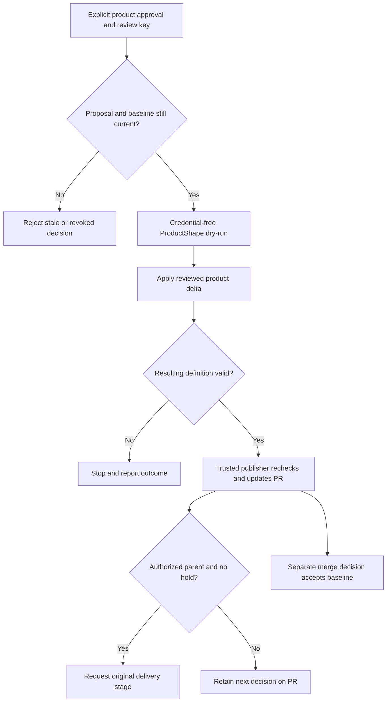

# Apply Product Change

Explicit owner approval of the current Product Change authorizes a separate provider apply. ProductShape materializes the reviewed definition on the issue branch; merge remains the baseline-acceptance decision.

## Interactions

Approval is bound to the proposal, baseline, owner and PR head. The credential-free job runs provider validation, dry-run and apply. The separately credentialed publisher rechecks the binding and publishes the model delta, receipt and affected citations. Dependent planning must use the resulting branch definition.

## Stops and decisions

Silence, green checks, a question answer or generic PR approval cannot replace the explicit Product Change decision. Future permits an explicitly approved apply but still pauses parent delivery. Invalid or uncertain apply/publication stops continuation; product approval grants no merge, release or deployment authority.

<!-- pdac:cite id="FR-PRODUCT-CHANGE-WORKFLOW" digest="sha256:de0a685599fb546839c0136a8d87ce1e59290343c8151bfdc46a9549102e4ceb" -->

## Implementation evidence

[Worker source](../../../src/packages/sdlc/workflows/lighthouse-sdlc-apply-product-change.md) · [Delivery contract](../../../src/packages/sdlc/README.md) · [Executable checks](../../../src/tests/product-change-publication.test.mjs)

[All workers](worker-catalogue.md) · [Runtime view](README.md)
