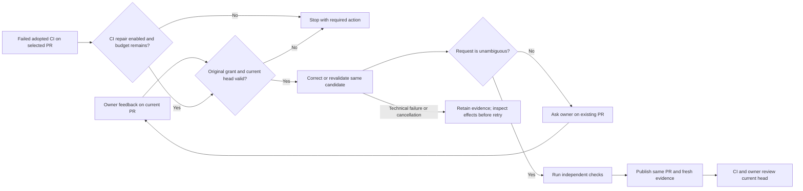

# Apply review

Owner feedback on an eligible proposal or implementation PR requests a correction of that same branch. Optional CI repair enters the same worker through a separately authenticated failure event.

## Interactions

The router binds feedback to the current discussion and retained implementation or proposal identity. The correction retains the original stage and write scope. A verification-only correction can publish fresh evidence without source changes.

## Stops and decisions

CI repair is opt-in, limited to two attempts for the PR identity, and does not reset when the head changes. Uncertain dispatch, active human work, changed authority and exhausted attempts stop it. Product proposals retain their provider validation and renewed product-decision requirements.

Execution failure, publication uncertainty and recovery follow the [shared maintenance boundary](maintenance.md).

<!-- pdac:cite id="FR-AUTHORIZED-WORKFLOW-ENTRY" digest="sha256:b859ab077d989e855c187e1823492a04c2924fb27f7d4f59cf18822cc912ee09" -->

## Implementation evidence

[Worker source](../../../src/packages/sdlc/workflows/lighthouse-sdlc-apply-review.md) · [Delivery contract](../../../src/packages/sdlc/README.md#bounded-ci-correction) · [Executable checks](../../../src/tests/proposal-review.test.mjs)

[All workers](worker-catalogue.md) · [Runtime view](README.md)
