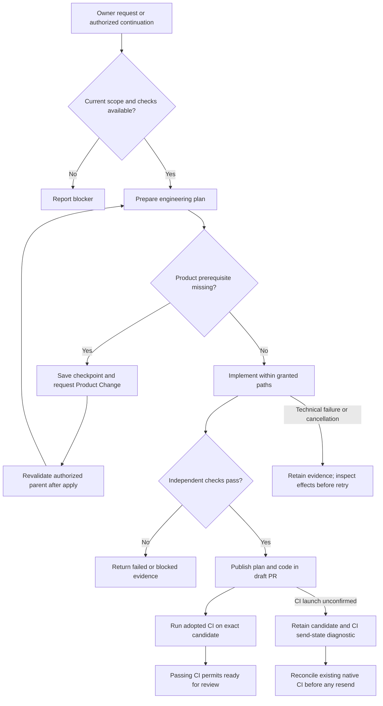

# Implement

An authorized implementation request or passed refinement starts planning, implementation and verification in one bounded workspace. The worker publishes its candidate as a draft PR.

## Interactions

The agent writes a candidate in its isolated workspace. Trusted host checks validate the actual candidate, and the publisher rechecks source, intent, reservation and write scope before updating the bot-owned branch. CI readiness is reconciled from checks on that PR head.

## Stops and decisions

An in-scope product gap can use the optional Product Change path while retaining the parent checkpoint. Missing scope authority requires an owner decision. Failed CI keeps the PR unready; optional CI correction uses apply-review. Implementation itself never merges.

Execution failure, publication uncertainty and recovery follow the [shared maintenance boundary](maintenance.md).

<!-- pdac:cite id="FR-AUTHORIZED-WORKFLOW-ENTRY" digest="sha256:b859ab077d989e855c187e1823492a04c2924fb27f7d4f59cf18822cc912ee09" -->

## Implementation evidence

[Worker source](../../../src/packages/sdlc/workflows/lighthouse-sdlc-implement.md) · [Delivery contract](../../../src/packages/sdlc/README.md) · [Executable checks](../../../src/tests/delivery-events.test.mjs)

[All workers](worker-catalogue.md) · [Runtime view](README.md)
