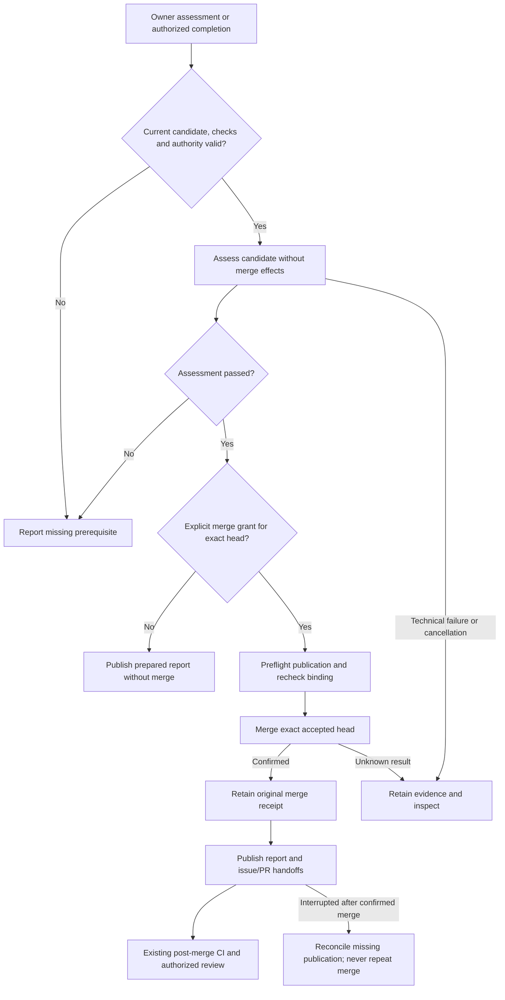

# Integrate

Integration assesses an implementation candidate against its current approvals, required checks and retained evidence. Only a separately authorized merge path can merge that candidate.

## Interactions

The host binds the assessment to the issue intent, PR head, base, policy, checks and owner decision. The host preflights the evidence target before merge, saves the actual merge receipt, then publishes the report and handoffs. If publication fails afterward, the confirmed merge remains an existing effect to reconcile. The merge operation includes the expected head; current GitHub rules still apply.

## Stops and decisions

The integrate label requests assessment and grants no merge permission. Prepared does not mean merged. A changed head requires a new approval. Missing provider evidence or failed checks blocks integration even when the worker run itself is green.

A cancellation or uncertain merge response cannot authorize another merge. [Maintenance](maintenance.md) can complete authenticated missing publication and review continuation; a blocked review remains blocked.

<!-- pdac:cite id="FR-AUTHORIZED-WORKFLOW-ENTRY" digest="sha256:b859ab077d989e855c187e1823492a04c2924fb27f7d4f59cf18822cc912ee09" -->

## Implementation evidence

[Worker source](../../../src/packages/sdlc/workflows/lighthouse-sdlc-integrate.md) · [Delivery contract](../../../src/packages/sdlc/completion.md) · [Executable checks](../../../src/tests/integration-request.test.mjs)

[All workers](worker-catalogue.md) · [Runtime view](README.md)
