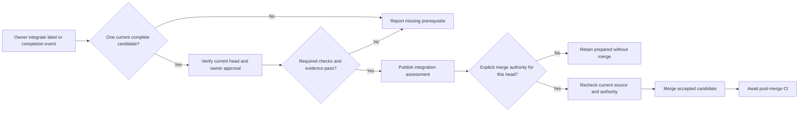

# Integrate

Integration assesses an implementation candidate against its current approvals, required checks and retained evidence. Only a separately authorized merge path can merge that candidate.

## Interactions

The host binds the assessment to the issue intent, PR head, base, policy, checks and owner decision. It retains process evidence before reporting success. The merge operation includes the expected head; current GitHub rules still apply.

## Stops and decisions

The integrate label requests assessment and grants no merge permission. Prepared does not mean merged. A changed head requires a new approval. Missing provider evidence or failed checks blocks integration even when the worker run itself is green.

## Implementation evidence

[Worker source](../../../src/packages/sdlc/workflows/lighthouse-sdlc-integrate.md) · [Delivery contract](../../../src/packages/sdlc/completion.md) · [Executable checks](../../../src/tests/integration-request.test.mjs)

[All workers](worker-catalogue.md) · [Runtime view](README.md)
