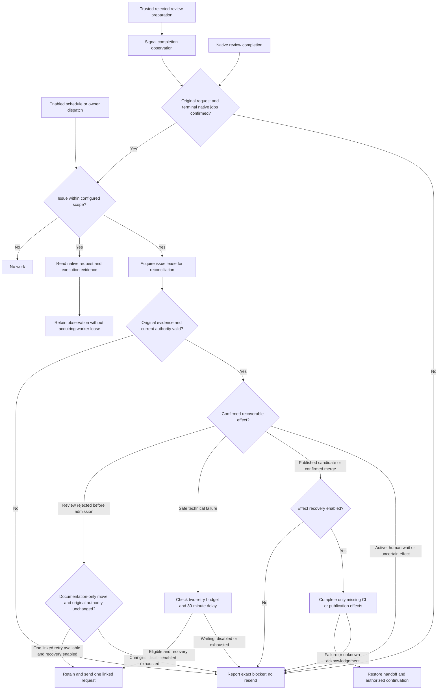
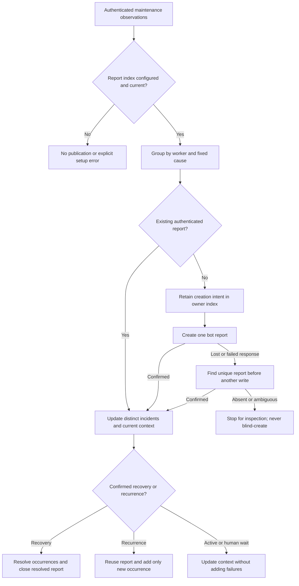

# Maintenance and worker reports

The optional deterministic workflow observes authenticated Actions/request evidence and reconciles only effects permitted by current authority. It runs no model itself; enabled recovery may request an existing worker. Installation, observation, recovery and reporting have separate gates in the [catalogue](worker-catalogue.md#availability-and-authority).

## Boundaries and outcomes

Observation retains current execution state even while a worker holds its lease. Reconciliation authenticates the original dispatch, scope, source and owner intent again. A safe interruption may request a linked retry; cancellation, changed authority, substantive failure, a human hold or a missing original artifact requires inspection. A retry of a CI correction retains its original correction round.

A confirmed review rejection before admission has one separate linked retry. Trusted preparation signals the reconciler directly; the native completion subscription and scheduled sweep enter that same path. The reconciler verifies terminal skipped jobs and reuses the original merge, CI and product apply. Duplicate signals and a later sweep do not create another delivery. The callback carries observation identity under the [existing authority boundary](../09-architecture-decisions/0008-separate-entry-and-autonomy.md); it grants no new effects. Event delivery and runner queues provide no recovery latency guarantee.

CI reconciliation observes exact native runs first. Only confirmed unsent or rejected requests can be resent within the existing delay/budget; unknown acknowledgements and legacy missing send-state evidence stop. A confirmed integration can restore its immutable report and missing handoff, then request review under the original grant and existing passing CI. It never repeats merge, agent assessment or CI to replace missing history. Restoring a blocked handoff preserves its blocker.

<!-- pdac:cite id="FR-AUTHORIZED-WORKFLOW-ENTRY" digest="sha256:b859ab077d989e855c187e1823492a04c2924fb27f7d4f59cf18822cc912ee09" -->

## Evidence and limits

Report publication has repository-wide serialization; per-issue reconciliation has the worker's issue lease. An uncertain request becomes the same occurrence when its run is found. Current execution, candidate head, retry state and fixed next actor/action remain separate from original incident identities. CI request failures retain safe operation/status metadata; reports exclude arbitrary source text, exception messages and raw logs. A worker success cannot resolve an uncertain CI launch. Manual archival does not assert recovery.

The publisher bounds its scan to 500 issue/PR entries, the index to 100 causes and each report to 200 observations within 60 KB. Overflow stops for operator archival. Artifact expiry does not recreate authority. [Operator configuration](../../../src/packages/sdlc/github-actions.md#worker-maintenance) owns enablement, scan scope and retention details.

[Workflow](../../../src/packages/sdlc/workflows/lighthouse-worker-maintenance.yml) · [Recovery](../../../src/packages/sdlc/src/worker-recovery.mjs) · [Admission recovery](../../../src/packages/sdlc/src/admission-recovery.mjs) · [CI recovery](../../../src/packages/sdlc/src/publication-recovery.mjs) · [Completion recovery](../../../src/packages/sdlc/src/completion-recovery.mjs) · [Reports](../../../src/packages/sdlc/src/worker-reports.mjs) · [Regression checks](../../../src/tests/worker-reports.test.mjs)

[Catalogue](worker-catalogue.md) · [Runtime view](README.md)
