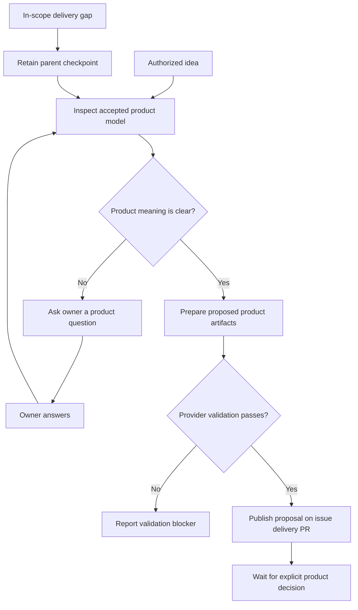

# Product Change preparation

An authorized idea, product answer or in-scope delivery gap enters the installed ProductShape workflow. The worker proposes a product delta and asks for an explicit decision.

## Interactions

The host supplies current product context and validates candidate artifacts through ProductShape before publication. A delivery gap retains its issue, parent stage and branch context; the review request identifies the actual delta, baseline and current PR head.

## Stops and decisions

Preparation does not change the accepted baseline. An answer clarifies intent; it does not approve apply. A revised proposal needs a current review binding. Waiting releases execution resources while retaining the checkpoint. Idea preparation alone grants no implementation authority.

<!-- pdac:cite id="FR-PRODUCT-CHANGE-WORKFLOW" digest="sha256:de0a685599fb546839c0136a8d87ce1e59290343c8151bfdc46a9549102e4ceb" -->

## Implementation evidence

[Worker source](../../../src/packages/sdlc/workflows/lighthouse-sdlc-product-change.md) · [Delivery contract](../../../src/packages/sdlc/README.md) · [Executable checks](../../../src/tests/product-change-files.test.mjs)

[All workers](worker-catalogue.md) · [Runtime view](README.md)
