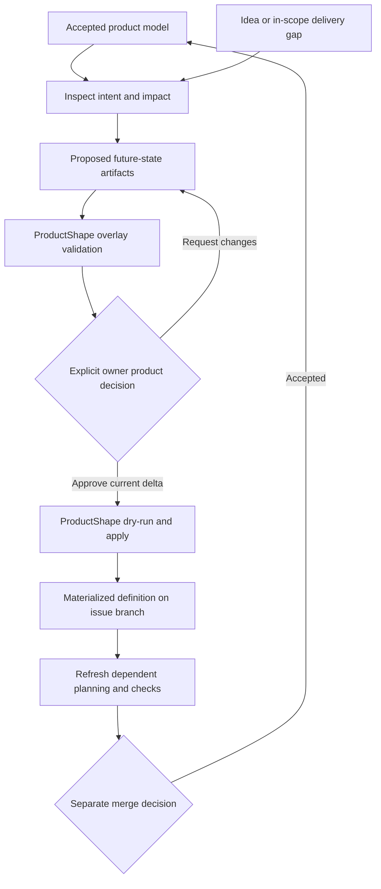

# Product Definition as Code

The product model is reviewable source under `docs/product/model/`. ProductShape validates the model and proposed deltas; Lighthouse coordinates the workers and decisions that move a change through delivery. ArcShape documents how the resulting system works.

## What each decision changes

| Step | Durable result | Authority |
| --- | --- | --- |
| Prepare | Proposed artifacts and impact, without replacing the baseline. | Authorized preparation worker and ProductShape validation. |
| Approve | A decision bound to the current proposal, baseline and PR head. | Explicit authenticated product decision by the owner. |
| Apply | Validated model changes on the issue branch, affected citations and an apply receipt. | ProductShape, invoked through the trusted apply path. |
| Resume | The original delivery stage uses the applied branch definition and refreshed planning. | Existing delivery authorization, freshly checked; holds still apply. |
| Merge | The resulting definition joins the accepted baseline. | Separate merge authorization and current repository checks. |

Apply materializes the reviewed definition. Merge accepts it into the baseline. Product and implementation changes may share a PR; product approval alone does not authorize implementation, merge, release or deployment.

<!-- pdac:cite id="FR-PRODUCT-CHANGE-WORKFLOW" digest="sha256:de0a685599fb546839c0136a8d87ce1e59290343c8151bfdc46a9549102e4ceb" -->

## Trace intent into implementation

Architecture and engineering documents cite the product artifacts they depend on. ProductShape verifies those citations against the referenced content. After apply, affected citations and dependent planning need review before continuation; green source checks do not replace that product evidence.

The installed OpenSpec bridge hosts worker proposals under `openspec/changes/<name>/product-change/`. ProductShape also supports its native Product Change directories. The accepted model remains the product authority in either hosting route.

[Preparation flow](product-change.md) · [Apply flow](apply-product-change.md) · [Product model](../../product/README.md) · [Provider apply implementation](../../../src/packages/sdlc/src/product-change-actions.mjs) · [Runtime view](README.md)
