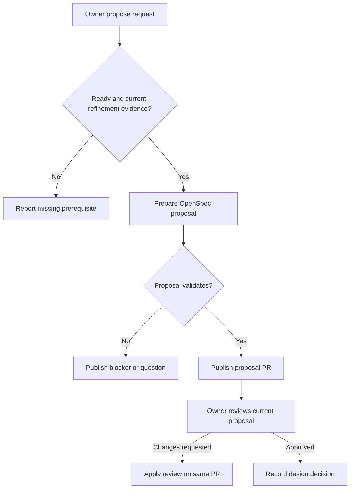

# Propose

The optional engineering-proposal worker prepares an OpenSpec plan after successful refinement. It publishes a separate proposal PR for review.

## Interactions

The worker writes proposal artifacts within its granted scope. The publisher retains the proposal and evidence on a bot-owned PR. Feedback returns to apply-review on that branch.

## Stops and decisions

Proposal approval records a design decision. It starts neither implementation nor merge. For a design-only request, future also prevents implementation continuation. Implementation can instead prepare its plan and code together without this separate proposal PR.

## Implementation evidence

[Worker source](../../../src/packages/sdlc/workflows/lighthouse-sdlc-propose.md) · [Delivery contract](../../../src/packages/sdlc/README.md) · [Executable checks](../../../src/tests/issue-actions.test.mjs)

[All workers](worker-catalogue.md) · [Runtime view](README.md)
