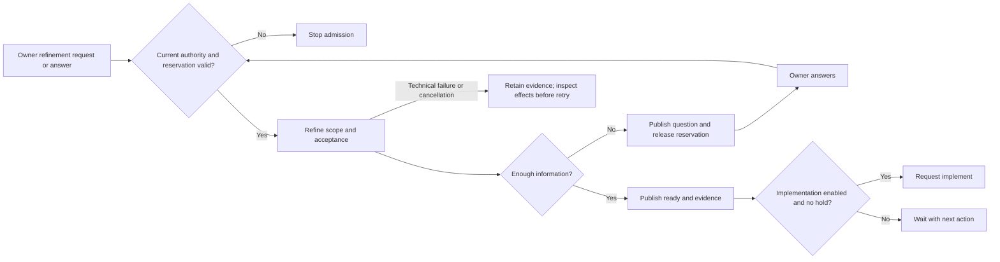

# Refine

An owner requests refinement or answers its pending question. The worker makes the scope and acceptance criteria actionable and reports whether implementation can proceed.

## Interactions

Preparation snapshots issue intent. The agent proposes an assessment; publication validates it against the current issue and owner answers. Only the resulting authenticated refinement evidence can support continuation.

## Stops and decisions

The future label pauses implementation. Missing authority, changed intent, human-working and unresolved questions stop admission or continuation. Ready is evidence of preparation, not merge permission.

Execution failure, publication uncertainty and recovery follow the [shared maintenance boundary](maintenance.md).

<!-- pdac:cite id="FR-AUTHORIZED-WORKFLOW-ENTRY" digest="sha256:b859ab077d989e855c187e1823492a04c2924fb27f7d4f59cf18822cc912ee09" -->

## Implementation evidence

[Worker source](../../../src/packages/sdlc/workflows/lighthouse-sdlc-refine.md) · [Delivery contract](../../../src/packages/sdlc/handoffs.md) · [Executable checks](../../../src/tests/issue-actions.test.mjs)

[All workers](worker-catalogue.md) · [Runtime view](README.md)
