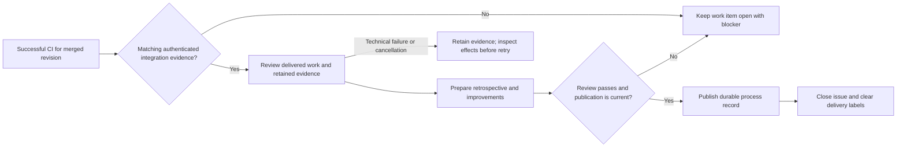

# Review and close

After an authorized merge and successful adopted post-merge CI, review checks retained integration evidence and records the delivery retrospective.

## Interactions

The host supplies the commit-pinned integration report, matching artifacts, accepted candidate and merge authorization. The worker records the retrospective and proposed improvements; the trusted publisher validates the result before closing the work item.

## Stops and decisions

Missing history, failed post-merge CI or a blocked review keeps the issue open. Closure establishes the delivery outcome covered by those checks; release and deployment require their own evidence and automation.

Execution failure, publication uncertainty and recovery follow the [shared maintenance boundary](maintenance.md).

<!-- pdac:cite id="FR-AUTHORIZED-WORKFLOW-ENTRY" digest="sha256:b859ab077d989e855c187e1823492a04c2924fb27f7d4f59cf18822cc912ee09" -->

## Implementation evidence

[Worker source](../../../src/packages/sdlc/workflows/lighthouse-sdlc-review.md) · [Delivery contract](../../../src/packages/sdlc/completion.md) · [Executable checks](../../../src/tests/sdlc-worker-completion.test.mjs)

[All workers](worker-catalogue.md) · [Runtime view](README.md)
