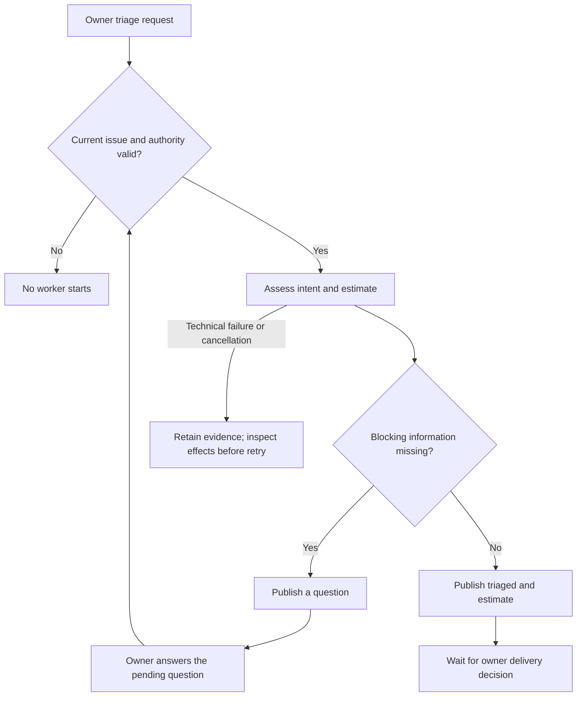

# Triage

An owner admits an open issue for assessment. Triage preserves the request, identifies missing facts and returns a provisional estimate; it does not dispatch refinement.

## Interactions

The router authenticates the request and serializes work on the issue. The worker distinguishes supplied facts from inferences; the trusted publisher rechecks the issue before publishing its assessment.

## Stops and decisions

A missing answer produces needs-info. An unrelated comment, duplicate request, closed issue or active human reservation cannot authorize another execution. A successful assessment stops at triaged.

Execution failure, publication uncertainty and recovery follow the [shared maintenance boundary](maintenance.md).

<!-- pdac:cite id="FR-AUTHORIZED-WORKFLOW-ENTRY" digest="sha256:b859ab077d989e855c187e1823492a04c2924fb27f7d4f59cf18822cc912ee09" -->

## Implementation evidence

[Worker source](../../../src/packages/sdlc/workflows/lighthouse-sdlc-triage.md) · [Delivery contract](../../../src/packages/sdlc/request-triage.md) · [Executable checks](../../../src/tests/issue-actions.test.mjs)

[All workers](worker-catalogue.md) · [Runtime view](README.md)
