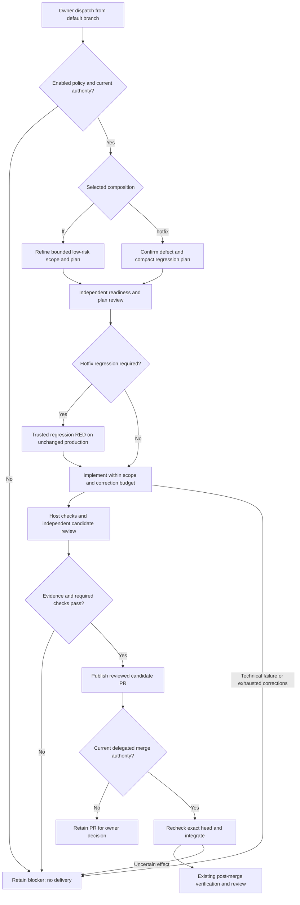

# Bounded unattended compositions

An owner dispatches `ff` or `hotfix` through the separately installed workflow. The host composes existing stages under project-owned policy; it authenticates the issue, scope, models, checks and budgets before running an agent. Initial execution and merge delegation are disabled independently.

<!-- pdac:cite id="FR-FAST-FORWARD-DELIVERY" digest="sha256:cc98eedbd3f9938c82ea59e4f7499d90a1cf4cf52da707d740d9f24d800bec2e" -->

<!-- pdac:cite id="FR-HOTFIX-ROUTE" digest="sha256:09b863353e0b8f4fa61b6826e2eb3e754ef68ae5e092a84336306b95a3da43e3" -->

## Boundaries and outcomes

Fast-forward requires a low-risk estimate, reversible scope and resolved dependencies. Hotfix requires a trusted assertion failure against unchanged production code and preserves the exact test bytes through GREEN and independent review. Setup failures cannot serve as RED. Distinct configured implementation/reviewer models must resolve to distinct model identifiers; that configuration does not prove provider identity or independence of reasoning.

The host enforces candidate paths, measured scope, required checks and at most two configured correction rounds. Questions, revoked authority, reservations and unavailable evidence stop advancement. Existing receipts make a rerun stop for inspection rather than repeat uncertain effects. A published candidate, delegated merge, post-merge acceptance, release and deployment remain separate outcomes.

[Workflow](../../../src/packages/sdlc/workflows/lighthouse-sdlc-unattended.yml) · [Host adapter](../../../src/packages/sdlc/src/unattended-actions.mjs) · [Policy and limits](../../../src/packages/sdlc/unattended.md) · [Acceptance boundaries](worker-catalogue.md#acceptance-evidence-and-limits)

[Catalogue](worker-catalogue.md) · [Runtime view](README.md)
