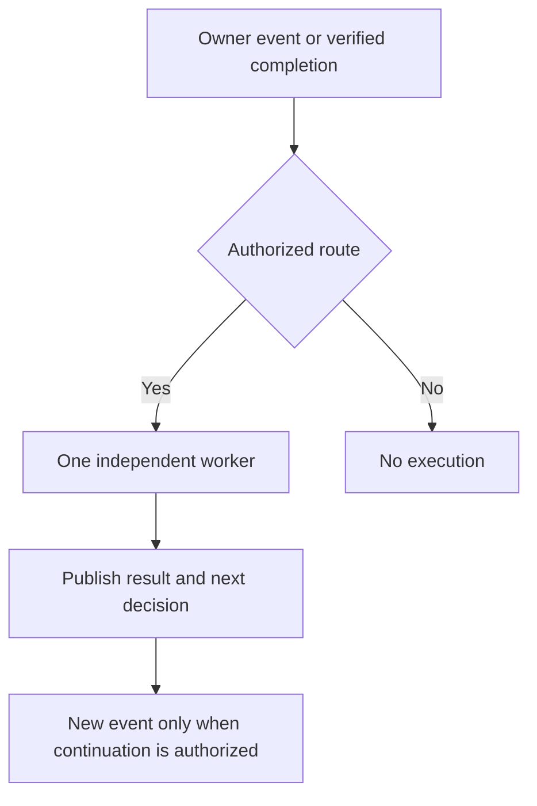

# Worker catalogue

A worker is one bounded execution with inputs, steps and a result. Lifecycle stages describe delivery decisions; a worker can perform a correction within an existing stage. GitHub Actions runs the work. Issue receipts link requests, executions and results.

Read the [packaged delivery guide](../../../src/packages/sdlc/README.md) for owner actions, labels and continuation.

## Route map

The [router source](../../../src/packages/sdlc/workflows/lighthouse-sdlc-router.yml) declares triggers; [routing and admission](../../../src/packages/sdlc/src/issue-actions.mjs) verifies their current meaning. Installation selects workers explicitly. Triage and refinement are installed by default; proposal, implementation and completion are selected by installer flags. Release remains the repository's separate release automation.

## Common execution boundary

The router records intent before sending. A worker authenticates the request and acquires the issue concurrency group before the agent starts. The agent produces a candidate; a separate trusted publisher rechecks source, intent, reservation and evidence before writing. A completed Actions run can contain a blocked assessment. An interrupted publication is uncertain until its actual effects are inspected.

| Receipt | Meaning | Operator action |
| --- | --- | --- |
| 📥 Requested | Dispatch recorded, worker unconfirmed | Inspect dispatch before resending |
| ▶️ Execution admitted | Worker claimed the request | Open Actions for current progress |
| ⏸️ Waiting for your response | Validated assessment needs a decision | Answer the identified question |
| ✅ Completed | Stage publication completed | Follow the declared next decision |
| ❌ Failed or cancelled | Execution did not publish a completed assessment | Inspect failure and effects before retrying |

## triage

[Executable source](../../../src/packages/sdlc/workflows/lighthouse-sdlc-triage.md). The owner admits an open issue by label or manual request. The worker preserves the request, cites inferences, asks blocking questions only and returns an explained provisional point estimate. External issue authorship grants no execution authority. A result stops at triaged without dispatching refinement.

## refine

**Entry:** Owner refine request or answer to its pending question. **Effects:** Issue comments and workflow labels; no product changes. **Stop:** Ready can continue to implementation under installed policy; future pauses it.

[Workflow source](../../../src/packages/sdlc/workflows/lighthouse-sdlc-refine.md) · [Lifecycle skill](../../../src/packages/sdlc/skills/refine/SKILL.md)

## propose

**Entry:** Owner planning request after authenticated refinement. **Effects:** Proposal artifacts and their bot-owned PR only. **Stop:** Planning stays separate from implementation and merge approval.

[Workflow source](../../../src/packages/sdlc/workflows/lighthouse-sdlc-propose.md) · [Lifecycle skill](../../../src/packages/sdlc/skills/propose/SKILL.md)

## implement

**Entry:** Owner implementation request, authorized refinement continuation. **Effects:** Configured product paths on a bot-owned branch; no merge. **Stop:** Passed candidate waits for acceptance; ambiguous scope asks the owner.

[Workflow source](../../../src/packages/sdlc/workflows/lighthouse-sdlc-implement.md) · [Lifecycle skill](../../../src/packages/sdlc/skills/implement/SKILL.md)

## integrate

**Entry:** Owner authorization for a PR head or verified delivery event. **Effects:** Protected process evidence; merge only with current explicit authority. **Stop:** Prepared does not mean merged; failed checks or owner decisions block.

[Workflow source](../../../src/packages/sdlc/workflows/lighthouse-sdlc-integrate.md) · [Lifecycle skill](../../../src/packages/sdlc/skills/integrate/SKILL.md)

## review

**Entry:** Authorized completion request for a merged PR. **Effects:** Process evidence and configured issue labels. **Stop:** Missing historical or post-merge evidence remains a blocker.

[Workflow source](../../../src/packages/sdlc/workflows/lighthouse-sdlc-review.md) · [Lifecycle skill](../../../src/packages/sdlc/skills/review/SKILL.md)

## apply-review

**Entry:** Authorized non-approval feedback on an existing bot proposal or implementation PR. **Effects:** Update that same branch within its existing scope after checking the current head and complete bounded discussion. **Stop:** Ambiguous requests need an answer; duplicate feedback starts no second correction. Approval goes through the integration policy.

[Workflow source](../../../src/packages/sdlc/workflows/lighthouse-sdlc-apply-review.md) · [Feedback authentication](../../../src/packages/sdlc/src/proposal-review.mjs)

## product-change

**Entry:** Owner selects Product Change from an issue idea or answers a pending product question. **Effects:** Prepare and publish a validated ProductShape proposal on the issue delivery PR. **Stop:** Wait for explicit product approval; idea entry does not authorize implementation.

[Workflow source](../../../src/packages/sdlc/workflows/lighthouse-sdlc-product-change.md) · [Product Change contract](../../../src/packages/sdlc/src/product-change.mjs)

## apply-product-change

**Entry:** Owner explicitly approves the current Product Change proposal. **Effects:** A credential-free job runs provider dry-run and apply, then a trusted publisher verifies and publishes the resulting model delta. **Stop:** Product approval does not authorize PR merge, release or deployment.

[Workflow source](../../../src/packages/sdlc/workflows/lighthouse-sdlc-apply-product-change.md) · [Approval and apply](../../../src/packages/sdlc/src/product-change-actions.mjs)

## Deterministic maintenance

[Maintenance workflow](../../../src/packages/sdlc/workflows/lighthouse-worker-maintenance.yml) · [Recovery decisions](../../../src/packages/sdlc/src/worker-recovery.mjs)

Installed with `--with-maintenance`, enabled separately by repository variables. No model runs here. The issue receipt, original request artifact and current Actions jobs identify the outcome. At most two linked retries are allowed, 30 minutes apart, only after confirmed failure before publication. A newer request supersedes earlier recovery candidates. Human decisions, changed authority and uncertain effects require intervention. See [enablement and scan bounds](../../../src/packages/sdlc/github-actions.md#worker-maintenance).

## Error reports

[Report publisher](../../../src/packages/sdlc/src/worker-reports.mjs) · [Operator setup](../../../src/packages/sdlc/github-actions.md#worker-error-reports)

One issue groups each worker/cause pair, with affected issues, execution links, observed counts and a next action. A serialized job uses an owner-selected index issue to record creation intent before sending. It never copies logs or agent prose. Same-request recovery closes resolved reports; a new failure reopens the same report. Missing evidence stays unresolved.

## Bounded unattended compositions

The opt-in [unattended workflow](../../../src/packages/sdlc/workflows/lighthouse-sdlc-unattended.yml) runs fast-forward or test-first hotfix through the existing lifecycle contracts. A trusted [host adapter](../../../src/packages/sdlc/src/unattended-actions.mjs) authenticates owner intent and policy, serializes the issue, supplies isolated engine executions and retains candidate/check evidence. The read-only reviewer uses a distinct configured model and returns a candidate-bound engineering judgement. The host performs publication and separately delegated integration after fresh checks; model output grants no permission.

Hotfix regression tests run against unchanged production code before repair; their bytes and RED/GREEN receipts remain bound to independent review. Scope and correction limits stop the composition before publication or integration. Existing supervised workers remain independently invocable. See [operator configuration](../../../src/packages/sdlc/unattended.md).

<!-- pdac:cite id="FR-FAST-FORWARD-DELIVERY" digest="sha256:cc98eedbd3f9938c82ea59e4f7499d90a1cf4cf52da707d740d9f24d800bec2e" -->

<!-- pdac:cite id="FR-HOTFIX-ROUTE" digest="sha256:09b863353e0b8f4fa61b6826e2eb3e754ef68ae5e092a84336306b95a3da43e3" -->
