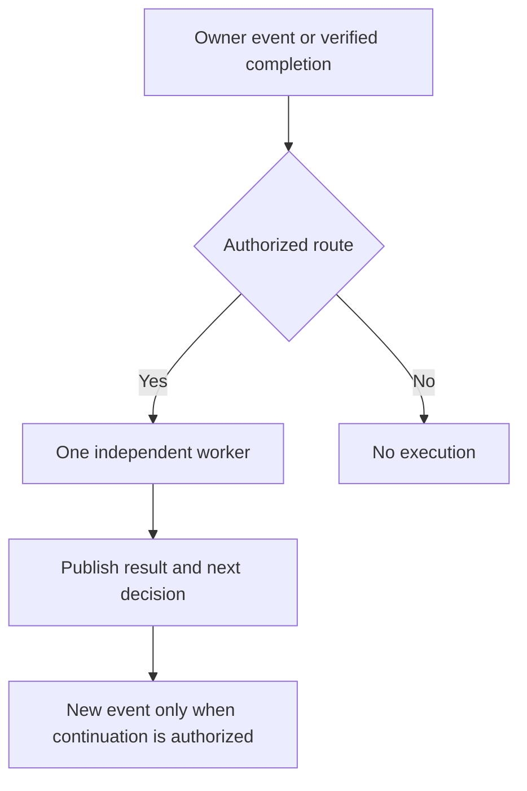

# Worker catalogue

A worker is one bounded execution with inputs, steps and a result. Lifecycle stages describe delivery decisions; a worker can perform a correction within an existing stage. GitHub Actions runs the work. Issue receipts link requests, executions and results.

Read the [packaged delivery guide](../../../src/packages/sdlc/README.md) for owner actions, labels and continuation.

## Route map

The [router source](../../../src/packages/sdlc/workflows/lighthouse-sdlc-router.yml) declares triggers; [routing and admission](../../../src/packages/sdlc/src/issue-actions.mjs) verifies their current meaning. Installation selects workers explicitly. Triage and refinement are installed by default; the remaining workers and compositions are opt-in. Release and deployment use their own automation.

## Availability and authority

| Evidence | What it establishes |
| --- | --- |
| Packaged source | The implementation exists; it may be unselected or unconfigured |
| Installed workflow | Reviewed source and compiled locks reference an immutable harness revision |
| Enabled policy | Current variables, adopted checks, issue scope and credentials permit admission |
| Native acceptance | A linked execution proves the stated case on its recorded revision, within its stated limits |

An npm upgrade does not update installed Actions workflows. The [installer](../../../src/packages/sdlc/src/install-workflows.mjs) and [operator guide](../../../src/packages/sdlc/github-actions.md) own installation and configuration.

| Selection or gate | Effective behavior |
| --- | --- |
| Default installation | Router, `triage` and `refine` |
| `--with-propose` | Adds `propose` and `apply-review` |
| `--with-implement` | Also adds `implement`; permits configured refinement continuation |
| `--with-completion` | Also adds `integrate` and `review` |
| `--with-product-change` | Adds `product-change` and `apply-product-change` |
| `--with-maintenance` | Adds deterministic observation, reconciliation and optional reports |
| `--with-unattended` | Adds `ff` and `hotfix` compositions plus completion workers; initial policy is disabled |
| `--with-epic` | Adds the [serial epic workflow](../../../src/packages/sdlc/workflows/lighthouse-sdlc-epic.yml) and completion workers; activation remains separate |
| `LIGHTHOUSE_AUTOMATION_ENABLED` | Repository admission switch; does not supply missing policy or approval |
| `LIGHTHOUSE_ENABLED_STAGES` | Installer-selected lifecycle stages in the reviewed router |
| `LIGHTHOUSE_AUTO_IMPLEMENT` | Allows authorized refinement to request implementation; `future` still pauses it |
| `LIGHTHOUSE_COMPLETION_ENABLED` | Allows integration/review routing; grants no merge permission |
| `LIGHTHOUSE_PRODUCT_CHANGE_ENABLED` | Allows product preparation, approval/apply and guarded parent resumption |
| `LIGHTHOUSE_MAINTENANCE_ENABLED` | Enables the separately installed maintenance scan and manual maintenance |
| `LIGHTHOUSE_MAINTENANCE_ISSUES` | Limits subjects; `[]` admits none, absence selects open owner issues, invalid data stops admission |
| `LIGHTHOUSE_RECOVERY_ENABLED` | Separately permits bounded retries and confirmed-effect recovery; checked again at worker admission |
| `LIGHTHOUSE_REPORT_INDEX_ISSUE` | Selects an open owner-authored report index; absence disables reports |
| `LIGHTHOUSE_CI_APP_CLIENT_ID` | Optional eligible CI connection, paired with the `LIGHTHOUSE_CI_APP_PRIVATE_KEY` Actions secret; grants no delivery or merge authority |
| `LIGHTHOUSE_EPIC_ENABLED` | Gates installed epic reconciliation and continuation; does not establish aggregate acceptance |
| `LIGHTHOUSE_EPIC_CAPACITY` | Bounds child admission; initial serial qualification uses one |
| `completion.ciRepair` in `.lighthouse/github.json` | Separately selects CI correction issues and budget; no global repair by default |
| `.lighthouse/unattended.json` | Selects enabled composition routes and budgets; merge delegation is separate |

Stage selection and router feature flags live in the reviewed workflow; the global automation and maintenance/report switches are repository variables. Installer defaults do not describe an adopter's existing policy: the installer preserves it. Changing an installed file or policy requires its normal review. The optional [epic delivery workflow](../../../src/packages/sdlc/epic-delivery.md) retains explicit child and aggregate merge decisions; its two-child native acceptance remains pending.

## Router and supported requests

| Event | Admission and continuation |
| --- | --- |
| Owner adds `triage`, `refine`, `propose` or `implement` | Request that stage under current issue, predecessor and reservation checks; triage stops after assessment |
| Owner adds `integrate` | Request assessment of the eligible candidate; the label grants no merge authority |
| Owner adds/removes `future` | Pause implementation, or resume a pending implementation request after rechecking authority |
| Owner answers the latest pending question | Resume only that question's stage; unrelated comments grant no work |
| Owner feedback on an eligible PR | Correct or revalidate the same PR through apply-review; approval follows proposal or integration policy |
| `workflow_dispatch` with `workflow: stage` | Request an enabled stage: `triage`, `refine`, `propose`, `implement`, `integrate` or `review`; completion requires its current PR/head binding |
| `workflow: product-change` | Prepare product intent; explicit current Product Change approval separately admits provider apply |
| `workflow: resume-product` or `workflow: resume-aligned` | Recheck retained product/parent evidence; these are guarded continuation routes, not fresh authority |
| Verified `workflow_run` or trusted CI callback | Match configured workflow path, repository, revision and candidate before readiness, correction or completion |
| Router schedule | Reconcile PR state and missed CI signals; does not enable worker recovery or a new delivery request |
| Owner unattended dispatch | Select `ff` or `hotfix` from its separate workflow and enabled policy |

The installer derives completion subscriptions from selected workers and adopted CI names. A subscribed display name alone cannot admit work. Equivalent events reuse the current request or candidate; uncertain dispatch stops rather than resending. `needs-info`, `waiting-review`, `human-working` and `agent-working` retain their documented question, decision and reservation boundaries. See the [label catalogue](../../../src/packages/sdlc/README.md#label-catalog) and [routing implementation](../../../src/packages/sdlc/src/issue-actions.mjs).

## Common execution boundary

The router records intent before sending. A worker authenticates the request and acquires the issue concurrency group before the agent starts. The agent produces a candidate; a separate trusted publisher rechecks source, intent, reservation and evidence before writing. A completed Actions run can contain a blocked assessment. An interrupted publication stays uncertain until authenticated reconciliation confirms its effects. A confirmed merge is never repeated to replace a missing report.

| Receipt | Meaning | Operator action |
| --- | --- | --- |
| 📥 Requested | Dispatch recorded, worker unconfirmed | Inspect dispatch before resending |
| ▶️ Execution admitted | Worker claimed the request | Open Actions for current progress |
| ⏸️ Waiting for your response | Validated assessment needs a decision | Answer the identified question |
| ✅ Completed | Stage publication completed | Follow the declared next decision |
| ❌ Failed or cancelled | Execution did not publish a completed assessment | Inspect failure and effects before retrying |

<!-- pdac:cite id="FR-AUTHORIZED-WORKFLOW-ENTRY" digest="sha256:b859ab077d989e855c187e1823492a04c2924fb27f7d4f59cf18822cc912ee09" -->

## triage

[Explore the triage flow](triage.md).

[Executable source](../../../src/packages/sdlc/workflows/lighthouse-sdlc-triage.md). The owner admits an open issue by label or manual request. The worker preserves the request, cites inferences, asks blocking questions only and returns an explained provisional point estimate. External issue authorship grants no execution authority. A result stops at triaged without dispatching refinement.

## refine

[Explore the refine flow](refine.md).

**Entry:** Owner refine request or answer to its pending question. **Effects:** Issue assessment and labels; a recorded product prerequisite can checkpoint the parent and request the separately installed Product Change worker. **Stop:** Ready can continue to implementation under installed policy; future pauses it.

[Workflow source](../../../src/packages/sdlc/workflows/lighthouse-sdlc-refine.md) · [Lifecycle skill](../../../src/packages/sdlc/skills/refine/SKILL.md)

## propose

[Explore the propose flow](propose.md).

**Entry:** Owner planning request after authenticated refinement. **Effects:** Proposal artifacts and their bot-owned PR only. **Stop:** Planning stays separate from implementation and merge approval.

[Workflow source](../../../src/packages/sdlc/workflows/lighthouse-sdlc-propose.md) · [Lifecycle skill](../../../src/packages/sdlc/skills/propose/SKILL.md)

## implement

[Explore the implement flow](implement.md).

**Entry:** Owner implementation request, authorized refinement continuation. **Effects:** Configured product paths on a bot-owned branch; no merge. **Stop:** Published candidate awaits exact-head CI and the separate review/merge decision. A CI launch failure retains its send state and safe diagnostics; ambiguity or changed authority stops continuation.

[Workflow source](../../../src/packages/sdlc/workflows/lighthouse-sdlc-implement.md) · [Lifecycle skill](../../../src/packages/sdlc/skills/implement/SKILL.md)

## integrate

[Explore the integrate flow](integrate.md).

**Entry:** Owner authorization for a PR head or verified delivery event. **Effects:** Protected process evidence; merge only with current explicit authority. **Stop:** Prepared does not mean merged; failed checks or owner decisions block.

[Workflow source](../../../src/packages/sdlc/workflows/lighthouse-sdlc-integrate.md) · [Lifecycle skill](../../../src/packages/sdlc/skills/integrate/SKILL.md)

## review

[Explore the review flow](review.md).

**Entry:** Authorized completion request for a merged PR. **Effects:** Process evidence and configured issue labels. **Stop:** Missing historical or post-merge evidence remains a blocker.

[Workflow source](../../../src/packages/sdlc/workflows/lighthouse-sdlc-review.md) · [Lifecycle skill](../../../src/packages/sdlc/skills/review/SKILL.md)

## apply-review

[Explore the apply-review flow](apply-review.md).

**Entry:** Authorized feedback on an existing bot proposal/implementation PR, or a selected failed CI event under the separate correction budget. **Effects:** Update that same branch within its existing scope after checking the current head and complete bounded discussion. **Stop:** Ambiguous requests need an answer; duplicate feedback starts no second correction. Approval goes through the integration policy.

[Workflow source](../../../src/packages/sdlc/workflows/lighthouse-sdlc-apply-review.md) · [Feedback authentication](../../../src/packages/sdlc/src/proposal-review.mjs)

## product-change

[Explore the product-change flow](product-change.md).

**Entry:** Owner selects Product Change from an issue idea or answers a pending product question. **Effects:** Prepare and publish a validated ProductShape proposal on the issue delivery PR. **Stop:** Wait for explicit product approval; idea entry does not authorize implementation.

[Workflow source](../../../src/packages/sdlc/workflows/lighthouse-sdlc-product-change.md) · [Product Change contract](../../../src/packages/sdlc/src/product-change.mjs)

## apply-product-change

[Explore the apply-product-change flow](apply-product-change.md).

**Entry:** Owner explicitly approves the current Product Change proposal. **Effects:** A credential-free job runs provider dry-run and apply, then a trusted publisher verifies and publishes the resulting model delta. **Stop:** Product approval does not authorize PR merge, release or deployment.

[Workflow source](../../../src/packages/sdlc/workflows/lighthouse-sdlc-apply-product-change.md) · [Approval and apply](../../../src/packages/sdlc/src/product-change-actions.mjs)

## Deterministic maintenance

[Maintenance workflow](../../../src/packages/sdlc/workflows/lighthouse-worker-maintenance.yml) · [Recovery decisions](../../../src/packages/sdlc/src/worker-recovery.mjs)

[Explore maintenance and recovery](maintenance.md). Observation is read-only and can report active work without waiting for its issue lease. Reconciliation serializes issue effects, rechecks original authority and may restore a missing handoff, reconcile retained CI send state or complete publication after a confirmed merge. Two linked technical retries, at least 30 minutes apart, remain separate from CI correction rounds. Missing origins, cancellations, human decisions and unknown effects cannot authorize a resend.

## Error reports

[Report publisher](../../../src/packages/sdlc/src/worker-reports.mjs) · [Operator setup](../../../src/packages/sdlc/github-actions.md#worker-error-reports)

One issue groups each worker/cause pair, with affected issues, execution links, observed counts and a next action. A serialized job uses an owner-selected index issue to record creation intent before sending. It never copies logs or agent prose. Authenticated same-request completion or a cause-specific confirmed effect resolves occurrences; recurrence reuses the report. Original incident counts remain separate from current execution, candidate and operator action. Active work and human waits add no failures; finding a run replaces its uncertain request placeholder. A requested CI run is not executed CI, worker success is not delivery acceptance, and manual archival does not claim recovery.

## Bounded unattended compositions

[Explore unattended compositions](unattended.md). The opt-in [unattended workflow](../../../src/packages/sdlc/workflows/lighthouse-sdlc-unattended.yml) runs fast-forward or test-first hotfix through the existing lifecycle contracts. A trusted [host adapter](../../../src/packages/sdlc/src/unattended-actions.mjs) authenticates owner intent and policy, serializes the issue, supplies isolated engine executions and retains candidate/check evidence. The read-only reviewer uses a distinct configured model and returns a candidate-bound engineering judgement. The host performs publication and separately delegated integration after fresh checks; model output grants no permission.

Hotfix regression tests run against unchanged production code before repair; their bytes and RED/GREEN receipts remain bound to independent review. Scope and correction limits stop the composition before publication or integration. Existing supervised workers remain independently invocable. See [operator configuration](../../../src/packages/sdlc/unattended.md).

<!-- pdac:cite id="FR-FAST-FORWARD-DELIVERY" digest="sha256:cc98eedbd3f9938c82ea59e4f7499d90a1cf4cf52da707d740d9f24d800bec2e" -->

<!-- pdac:cite id="FR-HOTFIX-ROUTE" digest="sha256:09b863353e0b8f4fa61b6826e2eb3e754ef68ae5e092a84336306b95a3da43e3" -->

## Acceptance evidence and limits

The retained exercises cover [admission and duplicate events](../../process/20261103-321-delivery-reconciliation/README.md), [same-PR verification](../../process/20261103-318-same-pr-verification/README.md), [integration assessment without merge](../../process/20261103-317-integration-admission/README.md), [CI correction](../../process/20261104-311-ci-repair/README.md), [interruption recovery](../../process/20261104-142-recovery/README.md) and [report lifecycle](../../process/20261104-143-reports/README.md). Each record bounds its revision, interventions and outcome. Recovery's final automatic review was blocked pending trace/cleanup; report qualification used controlled inputs around real native outcomes. Neither establishes unattended delivery for every route.

Product-prerequisite resumption and both entry paths have separate acceptance in [#211](https://github.com/juangcarmona/lighthouse/issues/211) and [#184](https://github.com/juangcarmona/lighthouse/issues/184). Real-change delivery, hotfix and independent verification remain separately evidenced through [#185](https://github.com/juangcarmona/lighthouse/issues/185), [#186](https://github.com/juangcarmona/lighthouse/issues/186) and [#101](https://github.com/juangcarmona/lighthouse/issues/101). Executor resource absence, child aggregation and a clean published consumer have their own checks in [#219](https://github.com/juangcarmona/lighthouse/issues/219), [#146](https://github.com/juangcarmona/lighthouse/issues/146) and [#216](https://github.com/juangcarmona/lighthouse/issues/216). Source presence or a green workflow does not close those boundaries.
