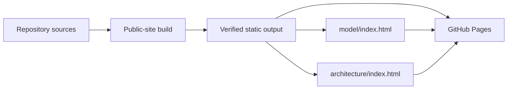

# 7. Deployment view

## Current Lighthouse delivery surfaces

| Surface | Input | Output | Runtime |
| --- | --- | --- | --- |
| CLI package | `src/packages/cli/` | Public npm package, with `0.1.0` bootstrap pending | Node.js |
| UI package | `src/packages/ui/` | CSS package with design contract | Consumer frontend toolchain |
| .NET reference profile | `src/dotnet/` | Reference assemblies and test output | .NET SDK |
| Public site | `src/public-site/`, ProductShape, ArcShape, assets and UI CSS | `dist/public-site/` with `model/` and `architecture/` snapshots | GitHub Pages |

GitHub Actions runs repository, .NET and visual checks. The public-site workflow is the single serialized publisher for the public engineering site: it validates the authorities and uploads the verified static output to GitHub Pages on `main` or a manual run.

## Target initialized application

An initialized application uses an Aspire AppHost as its local composition and execution boundary.

The AppHost composes the selected frontend, Lighthouse-owned backend modules and optional services such as requested microservices; a frontend-only project contains only the selected frontend and supporting services.

Production hosting, persistence, secrets, telemetry, scaling and recovery remain adopter-owned deployment decisions.

The Lighthouse repository itself has no hosted runtime.
