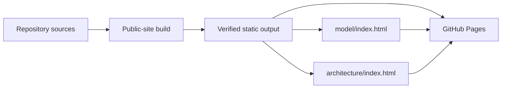

# 7. Deployment view

## Infrastructure level 1

| Surface | Input | Output | Runtime |
| --- | --- | --- | --- |
| CLI package | `src/packages/cli/` | Public npm package with Changesets-managed releases | Node.js consumer or CI |
| SDLC package | `src/packages/sdlc/` | Provider-neutral lifecycle contract package | Node.js and agent host |
| UI package | `src/packages/ui/` | CSS package with design contract | Consumer frontend toolchain |
| .NET reference profile | `src/dotnet/` | Reference assemblies and test output | .NET SDK in local or CI workspace |
| Public site | `src/public-site/`, ProductShape, ArcShape, assets and UI CSS | `dist/public-site/` with `model/` and `architecture/` snapshots | GitHub Pages |

GitHub Actions runs repository, .NET and visual checks. The public-site workflow is the serialized publisher for the public engineering site: it validates the authorities, creates the static output, captures review screenshots and uploads the verified output to GitHub Pages on `main` or a manual run.

## Topology rationale

The workspace has no Lighthouse server or production runtime. Package consumers run the CLI and SDLC validators in their own repository and agent host. The static site is the only hosted Lighthouse surface.

The .NET profile includes an Aspire AppHost as reference source for adopters, but that AppHost is not part of the Lighthouse runtime topology and the CLI does not deploy it.

Production hosting, persistence, secrets, telemetry, scaling and recovery remain adopter-owned deployment decisions.

## Building block mapping

| Building block or artifact | Infrastructure element | Environment |
| --- | --- | --- |
| CLI, SDLC and UI package sources | npm workspace and package tarballs | Local development, release CI and consumer install |
| Repository checks and authority validators | GitHub Actions runner or local toolchain | Pull request, `main` and local verification |
| Public-site builder | Node process with ArcShape, ProductShape and browser tooling | Site validation job |
| `dist/public-site/` | GitHub Pages artifact | Published static site |
| Adopter projections | Adopter repository and its CI | Consumer-owned environment |

<!-- pdac:cite id="BR-PUBLIC-SITE-PROJECTION" digest="sha256:e300dc42b79accf48aafa2877f68d42d5ce77edd218057f29b61ff81f97b47b9" -->

## Adopter execution host

The selected refinement worker requests `[self-hosted, linux, lighthouse-workflow]`. A dedicated Actions runner container starts an ephemeral OpenCode container on the adopter's Linux host. Preparation and publication jobs run on GitHub-hosted runners. Provider authentication and image configuration stay outside source trees; no factory service is called. The runner has its own home and temporary directories. Its work directory is mounted at the same absolute host path so sibling engine mounts resolve correctly.

Personal-account adopters may register repository runners on one machine. GitHub queues their jobs, while a shared operator `flock` path serializes engine execution across repositories. Each container has separate source and output mounts and bounded resources. One physical machine therefore needs one execution slot initially, not a persistent container per worker type. A larger pool can retain the same router and worker contracts.

This subscription profile uses Docker resource and filesystem isolation, with outbound networking and authentication inside the container. It does not provide AWF egress filtering or credential proxying. The runner itself has privileged Docker access and must execute only trusted workflows. See the [deployment example](../../../src/examples/opencode-engine/README.md) and [ADR-0009](../09-architecture-decisions/0009-gh-aw-repository-execution.md).

Implementation repositories can opt into [execution environments](../../../src/packages/sdlc/execution-environments.md). The host maps repository profile names to pinned local image IDs, checks prerequisites before agent startup and records the selected images. Optional PostgreSQL uses phase-specific bridge networks and disposable storage; independent validation receives a fresh database without provider credentials. The host owns provisioning and teardown, and neither the agent nor its checks receives Docker access. Undeclared consumers retain their existing image configuration. Local recipes and operating procedures are in the [environment build guide](../../../src/examples/opencode-engine/ENVIRONMENTS.md).
