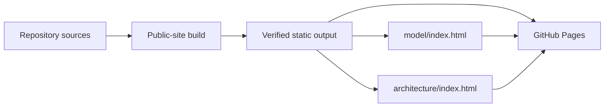

# 7. Deployment view

## Infrastructure level 1

| Surface | Input | Output | Runtime |
| --- | --- | --- | --- |
| CLI package | `src/packages/cli/` | Public npm package with Changesets-managed releases | Node.js consumer or CI |
| SDLC package | `src/packages/sdlc/` | Provider-neutral lifecycle contract package | Node.js and agent host |
| UI package | `src/packages/ui/` | CSS package with design contract | Consumer frontend toolchain |
| .NET reference profile | `src/dotnet/` | Reference assemblies and test output | .NET SDK in local or CI workspace |
| Public site | `src/public-site/`, ProductShape, ArcShape, assets and UI CSS | `dist/public-site/` with `model/` and `architecture/` snapshots | GitHub Pages |

GitHub Actions runs repository, .NET and visual checks. The public-site workflow is the serialized publisher for the public engineering site: it validates the authorities, creates the static output, captures review screenshots and uploads the verified output to GitHub Pages on `main` or a manual run.

## Topology rationale

The workspace has no Lighthouse server or production runtime. Package consumers run the CLI and SDLC validators in their own repository and agent host. The static site is the only hosted Lighthouse surface.

The .NET profile includes an Aspire AppHost as reference source for adopters, but that AppHost is not part of the Lighthouse runtime topology and the CLI does not deploy it.

Production hosting, persistence, secrets, telemetry, scaling and recovery remain adopter-owned deployment decisions.

## Building block mapping

| Building block or artifact | Infrastructure element | Environment |
| --- | --- | --- |
| CLI, SDLC and UI package sources | npm workspace and package tarballs | Local development, release CI and consumer install |
| Repository checks and authority validators | GitHub Actions runner or local toolchain | Pull request, `main` and local verification |
| Public-site builder | Node process with ArcShape, ProductShape and browser tooling | Site validation job |
| `dist/public-site/` | GitHub Pages artifact | Published static site |
| Adopter projections | Adopter repository and its CI | Consumer-owned environment |

<!-- pdac:cite id="BR-PUBLIC-SITE-PROJECTION" digest="sha256:e300dc42b79accf48aafa2877f68d42d5ce77edd218057f29b61ff81f97b47b9" -->

## Adopter execution host

The published workers request `[self-hosted, linux, lighthouse-sdlc]`; this selects a runner and does not call a factory service. An external-host projection must make that call explicitly. The host's database, account credentials, engine installation and operational configuration remain outside Lighthouse packages and consuming source trees.

A personal-account adopter may register one runner per repository on a shared machine. Cross-repository capacity and process isolation belong to the factory. Repository-level workflow concurrency cannot enforce a machine-wide capacity limit. GitHub documents the scope distinction in [self-hosted runners](https://docs.github.com/en/actions/concepts/runners/self-hosted-runners).
