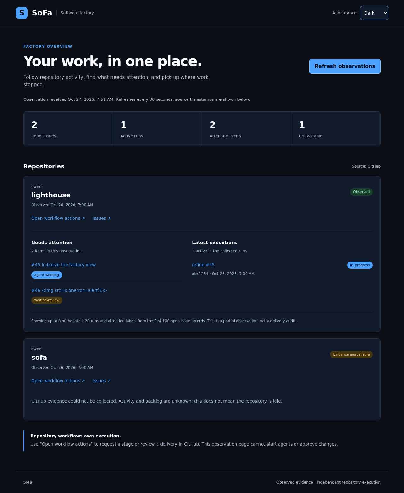
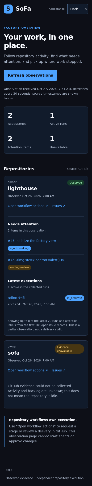
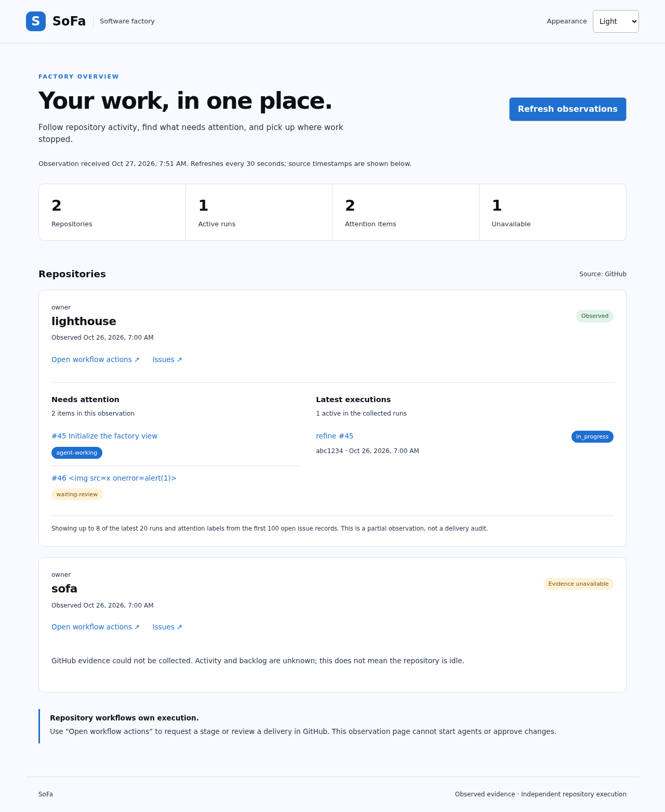
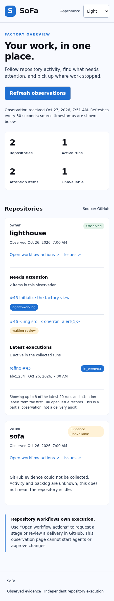

# Execution environment acceptance — issue 125

Technical checks passed on 27 October 2026. Owner approval remains required before merging [Lighthouse PR #129](https://github.com/juangcarmona/lighthouse/pull/129).

## Revisions

- Lighthouse: `8a0e0317d267f956fc7236d8e706a9bfe8bf4189`.
- SoFa: `45e66243219e51395cf85f3ef63429c72233fa2a`, [PR #64](https://github.com/juangcarmona/sofa/pull/64), based on the agreed `dd97c808d517c7afc8030b513f9efd6d31192cf7` baseline.
- [Build inputs](build-inputs.json) and [image identities](image-receipt.json) pin Node, SDK, PostgreSQL and the existing operator's OpenCode 2.1.0 binary. The binary checksum was compared with the installed implementation image before building. Both base and .NET images built locally; no registry publication or production rollout occurred.

## Results

| Check | Result | Evidence |
| --- | --- | --- |
| Clean container install and verification | `npm ci` and `npm run verify:container` exit 0; 27 Node, 36 .NET and 4 browser tests | [Receipt](checks.json), [complete log](consumer.log) |
| SoFa Docker host suite | 2 tests passed, none skipped | [Host log](sofa-host-tests.log) |
| SoFa unchanged default CI command | `npm run verify`: all 38 .NET, 27 Node and 4 browser tests passed | [CI log](sofa-ci.log), [Actions](https://github.com/juangcarmona/sofa/actions/runs/40469197104) |
| Exact-revision history and tree scan | 55 commits scanned, no leaks | [Security log](history-scan.log) |
| Real container lifecycle checks | 4 passed: fresh databases, nonzero failure, termination cleanup, workspace tools and clean Git metadata | [Container log](container-tests.log) |
| Adapter regression checks | 21 passed | [Adapter log](adapter-tests.log) |
| Lighthouse repository verification | 181 passed, 3 opt-in tests skipped here and exercised in the separate real-container run | [Verification log](lighthouse-verify.log) |
| OpenSpec | Strict validation passed | [OpenSpec log](openspec.log) |
| Remaining test resources | No matching containers, networks or volumes | [Cleanup receipt](cleanup.json) |

The container run used a fresh tracked-file snapshot, the declared dotnet profile, a fresh PostgreSQL service and the production independent-check adapter. It mounted no Docker socket or provider credential volume. Disposable Git metadata contains one snapshot commit with no remotes or inherited hooks; the separate history scan covers real earlier commits. The host-only engine tests ran on Bastion with its installed SDK; the application suite used the image's pinned SDK 10.0.100.

The lifecycle termination test removes the running check container and verifies service cleanup. It does not claim to exercise the entire Actions cancellation or adapter signal-handler path. These are technical test receipts, not approval to merge or a claim that production has been updated.

## Browser evidence

[Interactive browser report (download)](browser-report.html)

## Retrospective

The first real image build found an older Debian snapshot incompatible with packages already installed in the base image. The recipe now uses a compatible fixed snapshot. A Git-dependent security check also exposed the absence of safe Git metadata in disposable workspaces; implementation and validation now each create their own isolated snapshot repository.

SoFa's original verification command mixed application checks with two tests of the Docker host itself. The explicit container and host commands keep that boundary visible, and default CI still runs everything. Persistent .NET build servers were disabled for container verification after browser checks crashed following .NET tests while passing in isolation. The final complete container run passed.

Start running the actual image build and consumer verification before reporting environment support ready. Keep complete logs and immutable receipts with the PR. Stop treating a fixture-only test result or an agent-produced implementation as proof of runtime acceptance. A host prerequisite should become work for the trusted host, not a new manual task for the user.
