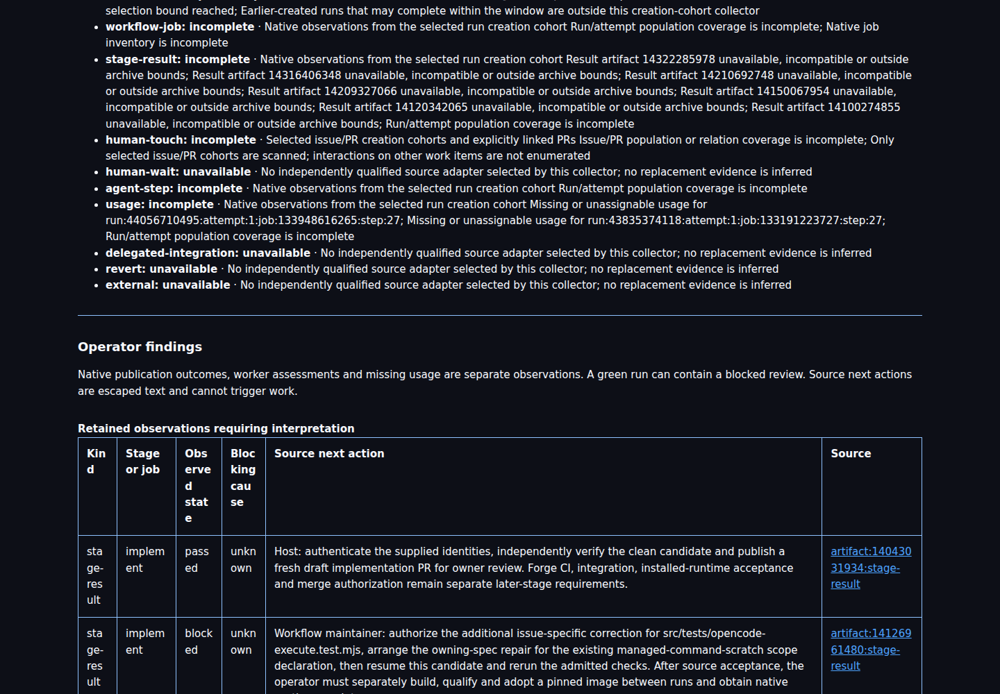
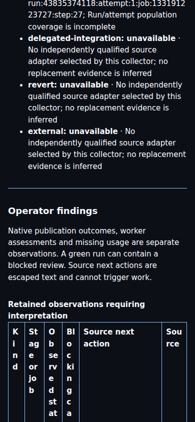

# Visual evidence for #221

Stage: implement. Source: `3f08e6a43ff63a86d610ef5b165b9818efb2ec5a`. Candidate tree: `1d57edff23528a7a562dceb90bb732d4ca191690`.

Native published-package qualification of the actual Lighthouse operator report; no visual or delivery acceptance is asserted.

## operator-report-wide: candidate

View: Lighthouse delivery observation report. State: Real bounded GitHub observations and explicit coverage gaps. Viewport: 1440 × 1000. Producer: agent-declared capture.

## operator-report-narrow: candidate

View: Lighthouse delivery observation report. State: Real bounded GitHub observations and explicit coverage gaps. Viewport: 390 × 844. Producer: agent-declared capture.

Proposed designs are illustrative. Candidate captures are agent-declared; the host verifies their bytes and binds them to the independently checked candidate tree. Images grant no visual acceptance, merge or release approval.
